<p align="center">
  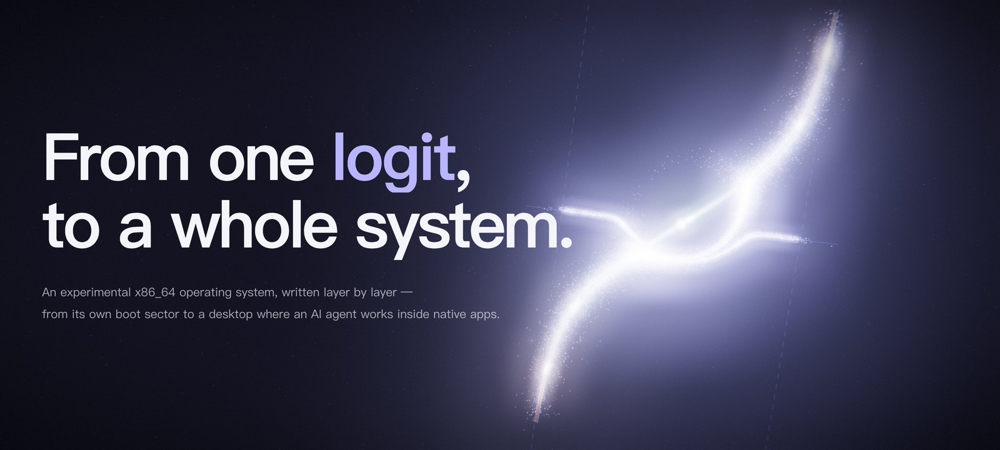
</p>

<p align="center">
  <a href="https://github.com/cai114514114514/LogitOS/releases/tag/v0.1.0-alpha"></a>
  
  
  
  <a href="LICENSING.md"></a>
</p>

<p align="center">
  <a href="#build--run"><b>Build &amp; run</b></a> ·
  <a href="#what-it-can-do"><b>What it can do</b></a> ·
  <a href="#the-agent-inside-the-system"><b>The agent</b></a> ·
  <a href="#what-does-not-work"><b>What does not work</b></a> ·
  <a href="#measured-not-claimed"><b>Numbers</b></a> ·
  <a href="TRANSPARENCY.md"><b>Transparency</b></a>
</p>

---

LogitOS is a standalone operating system for x86_64. It is **not** a Linux distribution, a Linux fork or a
skin over a host OS: it boots through **its own BIOS and UEFI loaders** and its own boot protocol, and the
kernel, drivers, filesystem, network stack, TLS, graphics stack, window system, browser engine, programming
language and applications are maintained in this repository — alongside clearly identified ports such as
QuickJS and NetSurf LibCSS (see [THIRD_PARTY.md](THIRD_PARTY.md)).

The name is the point. A *logit* is the raw score a model produces before it becomes a choice. LogitOS asks
what an operating system looks like when those scores have to land on a real machine: an agent service
(`agentd`) runs as an ordinary ring-3 process, sees only the files you hand it, and returns its work to native
applications as a reviewable proposal — never as a silent edit.

**How it is made.** LogitOS is human-directed and its first-party production code is written by AI coding
agents, as a matter of policy. Humans set goals, design the architecture, review, test, verify and integrate.
Every test is expected to carry a *negative control* — a deliberately broken build that the test must catch —
and user-interface work is checked screen by screen in QEMU against the previous image. See
[CONTRIBUTING.md](CONTRIBUTING.md) and [TRANSPARENCY.md](TRANSPARENCY.md).

> **Status: experimental.** LogitOS is a research and learning system. There is no security support and no SLA.
> Do not use it to protect real credentials, personal data, keys or production workloads, and do not treat its
> browser, TLS, isolation, filesystem or drivers as a security boundary. See [SECURITY.md](SECURITY.md).

## At a glance

Lines of code in git-tracked files on `main` (2026-10-29, comments and blank lines included):

| Layer | Where | Lines |
|---|---|---:|
| Boot (BIOS + UEFI loaders, long-mode entry) | `c/boot/` | 3,948 |
| Kernel (window compositor, processes & loader, memory, CPU/ACPI, scheduler, …) | `c/kernel/` | 66,547 |
| Drivers (USB, GPU, NICs, block, audio, virtio, power, timers) | `c/drivers/` | 35,200 |
| Filesystem (LogitFS, VFS, procfs, ramfs, caches) | `c/fs/` | 9,366 |
| Network and cryptography (IP, TCP, DNS, TLS, HTTP/1.1 + HTTP/2, SSH) | `c/net/`, `c/crypto/` | 55,975 |
| Graphics, text and media libraries | `c/lib/` | 84,942 |
| Browser engine | `c/apps/gui/browser/` | 131,650 |
| AetherScript language | `c/apps/as/` | 23,649 |
| C library | `c/apps/libc/` | 19,545 |

In total `git ls-files` tracks about 1.14 million lines of code, across more than 1,690 commits since 2026-05-30.

<table>
  <tr>
    <td width="50%">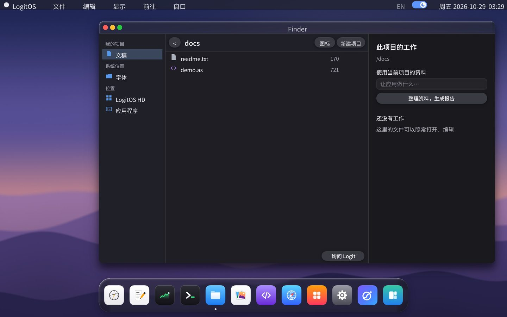</td>
    <td width="50%">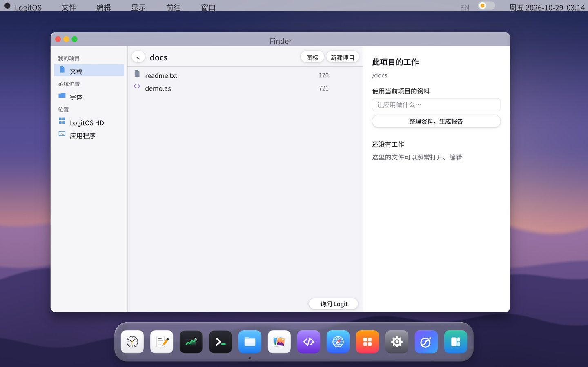</td>
  </tr>
  <tr>
    <td>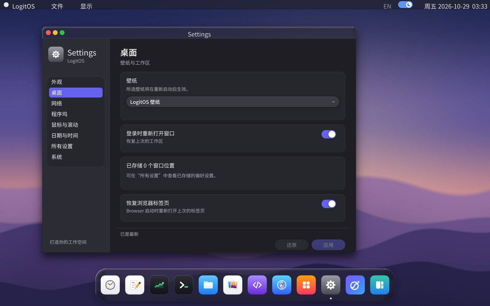</td>
    <td>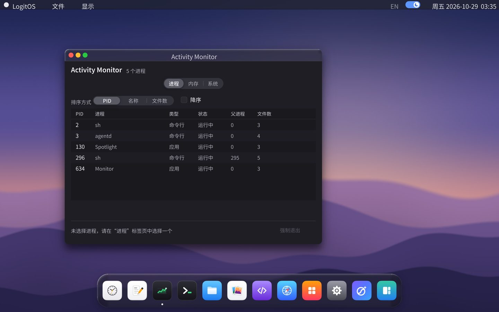</td>
  </tr>
  <tr>
    <td>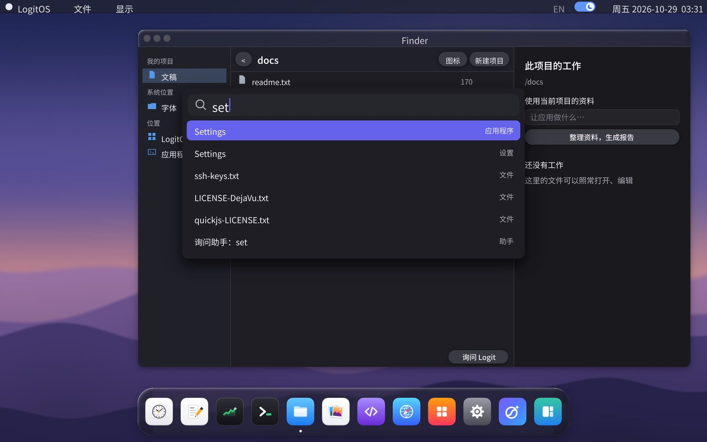</td>
    <td>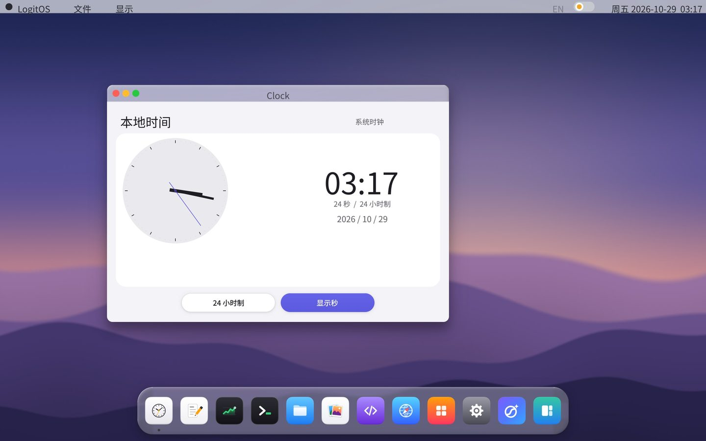</td>
  </tr>
</table>
<p align="center"><sub>Real screenshots from QEMU, captured at 2560 × 1600 by the project's own UI tour (<code>tools/ui_tour.py</code>).</sub></p>

### How the layers fit

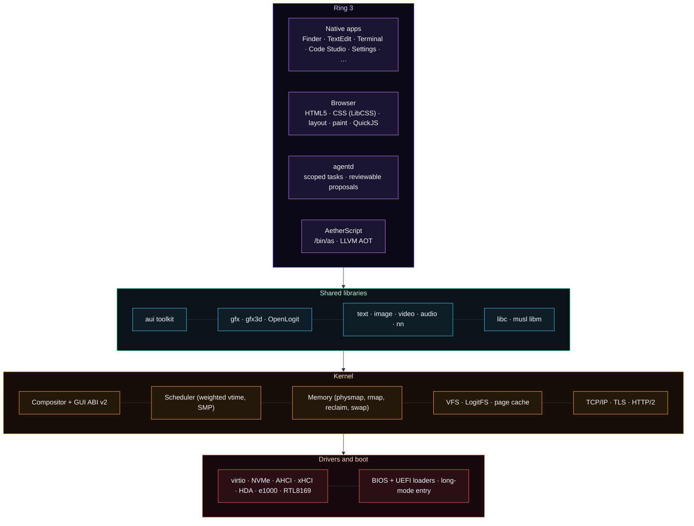

### A real boot, as it prints

<details open>
<summary>Selected lines from one boot's serial output (QEMU, 4 vCPUs, 512 MiB)</summary>

```text
LOADER ENTER KERNEL
LOGIT_BOOT_NATIVE_OK version=0001
[logitos] long mode, C kernel running
[prot] bsp: nx sup/ON  wxsplit ON  smep sup/ON  smap sup/off
[time] source=tsc 1000.005 MHz res=1ns  (invariant-tsc=no hypervisor=yes calib=pit-ch2)
[mm] boot: 131037 frames total (511 MiB), 118514 free, 12523 used, 0 shared, 12523 refs, 0 pinned, 0 bugs
[rmap] 131037 frames, 196555 nodes (3599 KiB total: 511 KiB heads + 3071 KiB nodes)
[logitos] interrupts + memory + gdt/tss online
[pcache] up: 65518 page slots (262072 KiB ceiling), 32 file slots, 16384 buckets
[blk] 1 disk, 0 partitions; root = vblk0 (LogitFS superblock)
[fs] mounted
[tls] trust store: 130 roots, 0 skipped
[dhcp] bound 10.0.2.15/24 gw 10.0.2.2 dns 10.0.2.3
[ime] /ime/pinyin-qwen.dat: 1983418 bytes, 49000 pinyin keys -- Shift+Space toggles pinyin input
[logitos] desktop up; mouse + keyboard armed
[smp] 4/4 CPUs online
[smp] parallel present on 4 cores (IPI 241)
LOGIT_BOOT_OK
[wm] launched Finder
[sched] first-run tid 11 (Finder)
[sched] first-run tid 14 (agentd)
```

</details>

## What it can do

### Boot, kernel and memory

- **Its own boot path, BIOS and UEFI.** `tools/mkiso.py` writes the ISO, `c/boot/bios/` brings the machine up
  from the El Torito boot sector and `c/boot/efi/loader.c` does the same under UEFI. A real boot under QEMU
  reports, in order: loader → long mode → CPU and protection setup → memory accounting → interrupts and devices
  → LogitFS mounted → TLS trust store → network → desktop → SMP bring-up → `LOGIT_BOOT_OK` → the first ring-3
  apps.
- **SMP.** Application processors are brought up through ACPI, the LAPIC and a trampoline (`[smp] 4/4 CPUs
  online`). The big kernel lock is gone: synchronisation follows object ownership
  ([docs/BKL_REMOVAL_2026-09-10.md](docs/BKL_REMOVAL_2026-09-10.md)).
- **A weighted scheduler.** On every 100 Hz tick each core runs the runnable thread with the smallest weighted
  virtual time, where `weight = round(1024 · 2^(−nice/10))` — a decade of nice is exactly a factor of two, and the
  table spans 4096:274. A waking thread is placed at the run ring's virtual "now", so it runs soon but banks no
  credit for having slept (`c/kernel/sched/sched.c`).
- **Memory.** Per-process address spaces, a physical map backed by 2 MiB pages, per-frame metadata (bitmap,
  poison map, 2-byte reference counts), reverse mapping, page reclaim, swap and a page cache. On a deliberately
  small 192 MiB machine running the desktop plus a program mapping more memory than exists, thousands of frames
  are evicted per run with no allocation failures.
- **A boundary between ring 3 and the kernel.** NX, SMEP and W^X are enabled at boot; every pointer crossing the
  syscall boundary is validated with the user bit required at every level of the page walk, and `make test-sec`
  runs one attack per process from `/bin/secprobe`. SMAP is not enabled yet.

### Storage, devices and networking

- **LogitFS** — a journalled (write-ahead log, `data=ordered`) read-write filesystem with record checksums,
  barriers that actually reach the device, and a read-only `fsck` at every mount. `make test-durability` boots one
  image five times **without `-snapshot`**, and 1,744 host checks cut power at every single device write.
- **Devices** — virtio 1.0 (blk, gpu, net), AHCI and NVMe, xHCI with USB HID and storage, Intel HDA audio,
  Intel e1000 and Realtek RTL8169/8139, plus ATA, PS/2 and VGA fallbacks.
- **Networking** — project implementations of Ethernet/ARP, IPv4 and IPv6 with neighbour discovery, DHCP, TCP,
  UDP, DNS, HTTP/1.1 and **HTTP/2** (frames and HPACK), a connection pool and a cookie jar. **TLS 1.3 and 1.2**
  with x25519 and P-256/384/521, HelloRetryRequest and PSK resumption (`psk_dhe_ke` only), a limited X.509
  verifier and a 130-root trust store; interop is checked against a real `openssl s_server` across 48 cases. See
  the [network support matrix](docs/NETWORK.md).

### Graphics, text and the desktop

- **A graphics stack of its own** (`c/lib/gfx`, `c/lib/gfx3d`): vector paths and strokes, arcs and squircles,
  linear, radial and conic gradients, Porter–Duff blending, filtered image blits, clip stacks and opacity groups,
  analytic shadows, four tiers of glass material with backdrop blur and adaptive tint, easing curves and
  fixed-point springs — and a software 3D pipeline with raster state, depth, culling, mipmapped textures, and a
  shading language (LSL) compiled to a small IR and VM. Applications reach the compositor through a validated
  GUI ABI v2 (`SYS_GUI_PATH`, `GLASS2`, `SHADOW2`, `BLIT2`, `BACKDROP`, `TEXT_RUN2`).
- **Text** — TrueType and CFF outlines, colour fonts, OpenType shaping, bidi, UAX #14 line breaking, paragraph
  layout with head/middle/tail ellipsis, medium and semibold UI faces, and quarter-pixel glyph placement. A pinyin
  input method is built in (Shift+Space).
- **The desktop** — a compositor with damage tracking, a menu bar, a Dock, Spotlight, notifications, zoomed
  windows and a toolkit (`aui`) shared by the native apps: Finder, TextEdit, Terminal, Code Studio, Clock,
  Activity Monitor, Preview, Settings, the Browser and more. A new interface language, 「澄」 *Clarity*, is being
  rolled out; its first three waves (tokens, the widget toolkit, the window-manager split, generated app icons)
  are merged.

### The browser

- **A spec HTML5 parser** — tokenizer **7032/7032** and tree construction **1723/1818** on the shared
  html5lib corpus (data only; the runner and the parser are ours), including the adoption agency algorithm and
  foster parenting.
- **Live pages** — a persistent QuickJS runtime with timers, `requestAnimationFrame`, a drained microtask queue,
  full capture/target/bubble event dispatch and real default actions; a CSSOM with scoped invalidation; `fetch`
  with streaming bodies, `XMLHttpRequest`, storage, observers, `structuredClone`, `Intl`, ES modules and more.
- **Media** — H.264 High profile and H.265 Main/Main 10 decoders held to **byte identity with ffmpeg** (a real
  1080p stream decodes byte for byte across 254 frames); MPEG-1/2, MPEG-4 Part 2 and MJPEG; WAV, FLAC, MP3, AAC,
  Vorbis and Opus; MP4/fMP4 and Matroska/WebM demuxing; PNG, JPEG, GIF (animated), WebP, APNG, ICO, BMP and EXIF.

### The agent, inside the system

- `agentd` is a ring-3 broker. A task sees only the files you select; its output comes back to the app that owns
  the document as a **candidate**, shown in TextEdit's work panel next to the text. Nothing changes until you
  apply it, a pending review survives a reboot, stale decisions are refused, and you can always keep the current
  version.
- Models are reached through a host gateway (`tools/agent_gateway.py`) so provider credentials never enter the
  guest; the guest gets a one-time capability for a single bounded endpoint. A local inference path for GGUF
  models lives in `c/lib/nn`.
- A real run on 2026-10-29 (DeepSeek, BIOS, 512 MiB): **21 checks passed in 72 seconds**, six model calls, all
  HTTP 200 — drafting a cited report, preserving a hand-written sentence, holding the proposal for review across
  a power cycle, applying and saving it, and keeping the document unchanged when asked.

<table>
  <tr>
    <td width="50%">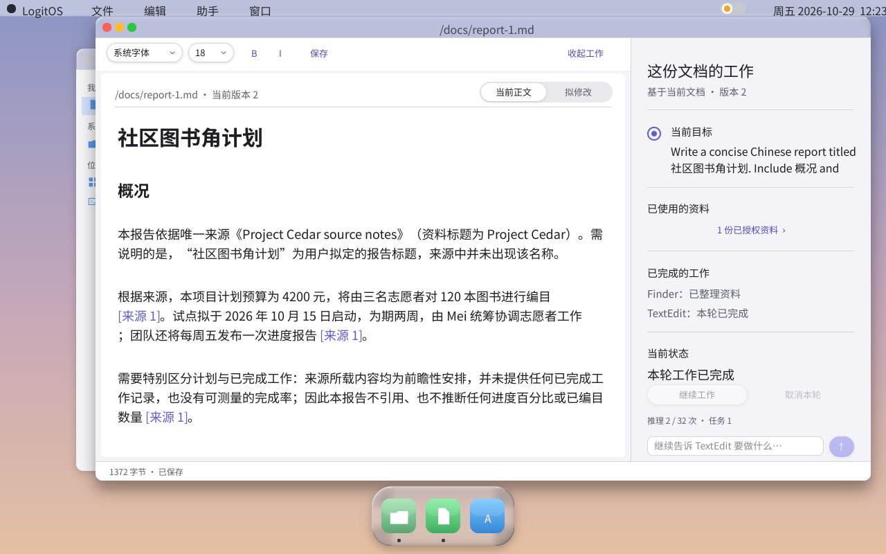<br><sub><b>1 · First draft.</b> The model writes the report from the one authorised source; every fact carries a source marker.</sub></td>
    <td width="50%">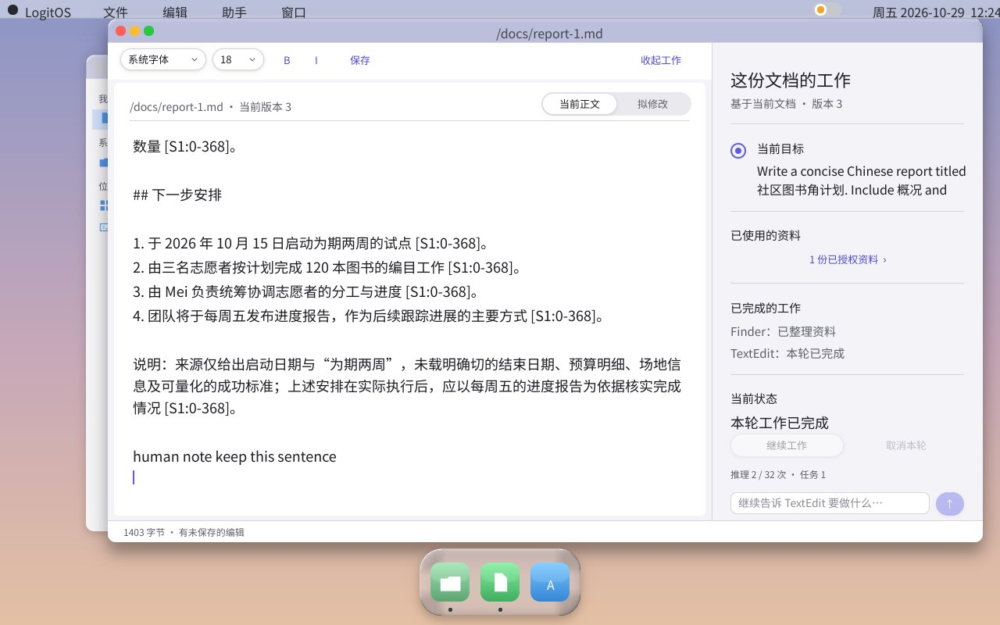<br><sub><b>2 · You edit.</b> A hand-typed sentence, still unsaved, is visible to the task.</sub></td>
  </tr>
  <tr>
    <td>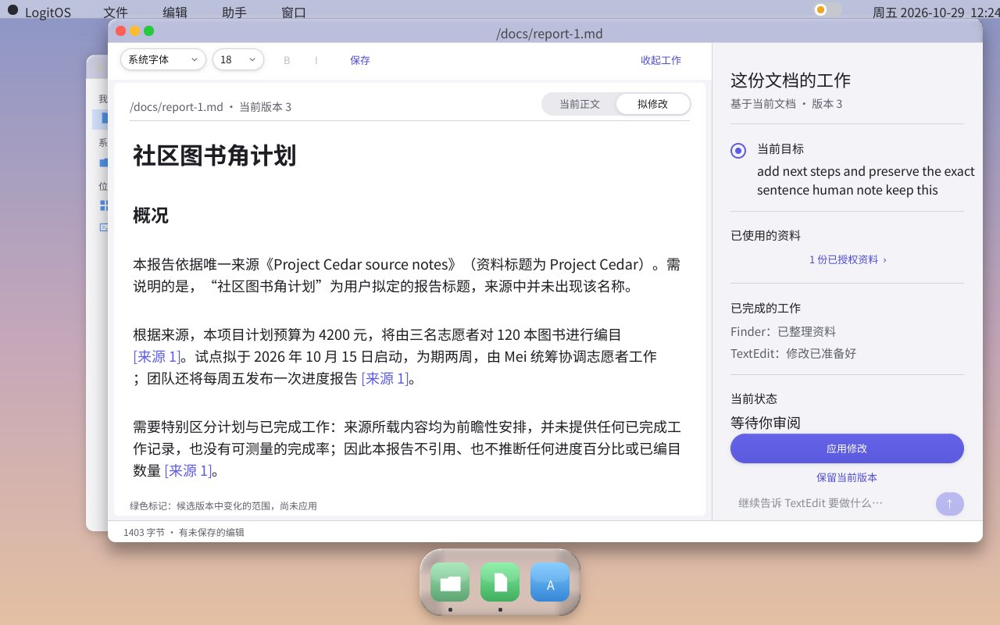<br><sub><b>3 · Review first.</b> The new proposal waits under “拟修改”; the document is unchanged until you decide — even across a reboot.</sub></td>
    <td><br><sub><b>4 · Apply.</b> Version 3 → 4, and the file on disk is verified byte for byte.</sub></td>
  </tr>
</table>

| Real run, 2026-10-29 | |
|---|---|
| Model | DeepSeek via `tools/agent_gateway.py` (credentials stay on the host) |
| Machine | QEMU, BIOS boot, 512 MiB, built from `e9f706413` |
| Result | 21 checks passed · 72 s end to end · includes one power cycle |
| Model calls | 6 · all HTTP 200 · 2.76–4.26 s each |
| Driver | `tests/boot/run-textedit-work.py --gateway …` — real QMP mouse and keyboard input, no synthetic RPC |

### AetherScript

A project language in `c/apps/as/` (`/bin/as`, `.as` files) with Python-flavoured syntax. Its single-pass
bytecode compiler and stack VM have clox (*Crafting Interpreters*) lineage; AetherScript 3 adds static types and
ahead-of-time native compilation of a supported subset through LLVM. Integers are machine words, so programs can `peek`/`poke` memory and make syscalls
directly — systems programming that reads like Python. It ships with the LibLogit standard library and the Code
Studio editor. The LibLogit standard library (`/usr/as/lib`) provides `seq`, `dicts`, `strings`, `sets`,
`stats`, `random`, `paths`, `bits`, `math` and `mathx`, with a `test` assertion module; Code Studio saves, runs
`/bin/as` over a pipe into an output pane and jumps to the reported error line. See
[docs/AETHERSCRIPT_LANGUAGE_3.md](docs/AETHERSCRIPT_LANGUAGE_3.md).

```python
# aether: 3
def main() -> None:
    message: str = "Hello, LogitOS."
    print(message)
```

## Measured, not claimed

Where a claim can be measured, the number is the claim.

| What | Result | How it is held |
|---|---|---|
| HTML5 tokenizer | **7032 / 7032** | shared html5lib corpus, plus a byte-at-a-time cross-check |
| HTML5 tree construction | **1723 / 1818** | same corpus; the remaining failures are categorised and ratcheted |
| H.264 High profile | **byte-identical** to ffmpeg over 254 frames of a real 1080p stream | `make test-h264`, and on device `make test-video` (guest CRC = host CRC) |
| H.265 Main 10 | matches the ITU conformance package's own MD5 over 256 pictures | conformance streams (B slices: see below) |
| AAC-LC | inside the MPEG full-accuracy bound on **30 of 41** ISO bitstreams | ISO reference waveforms, not another decoder |
| TLS interop | **48 cases** against a real `openssl s_server` | `make test-tls-interop`, throwaway CA |
| Filesystem durability | **1,744** host checks cutting power at every device write; five real boots without `-snapshot` | `make test-durability`, `make test-fscrash` |
| Connection reuse | one real page: 15 requests, **13 reused connections** | measured in the browser's pool |
| DOM allocation | a 120k-node parse went from **110 s to 29 ms** after moving to a chunk arena | browser host tests |
| Real-model agent run | **21 / 21** checks, 6 / 6 calls HTTP 200 | `tests/boot/run-textedit-work.py --gateway` |

One number is worth keeping for its own sake: on that real 1080p stream, **53 of 104 frames come out of decode
order**. Pairing timestamps with a decode-order queue — what the player did before B-frames existed — would have
silently mis-timed half of them.

### Tests that can fail

An audit once found **26 dead harnesses, 15 that printed a verdict and exited 0 either way, and 217 `test-`
targets wired into no suite** — including a five-boot durability proof that had apparently never run. Since then:

- `make test-audit` fails the build when a harness cannot fail, and its suite list is derived from the Makefile,
  because a hand-written list is exactly what rotted.
- `make ci` clean-clone-builds HEAD and asserts the artifacts exist instead of trusting make's exit status.
- Most gates carry a **negative control**: the same test against a build with the fix compiled out, which is
  required to fail.
- `make test-html5lib` reports a **rate** and diffs against a committed expected-failure list: a gate that is red
  for weeks only teaches people to stop reading the build.
- `make shot` exists to answer one question — when `make run` shows an empty QEMU window, is the guest not
  drawing or the host not painting? If the screenshot is correct, stop looking at this repository.

## What does not work

Kept deliberately, and kept specific.

- **No Media Source Extensions**, so a `<video>` on a real streaming site does not play: the decoders exist, but a
  page cannot feed them separate fMP4 segments.
- **Large single-page applications do not load acceptably.** QuickJS compiles eagerly with no pre-parse; a site
  shipping 12.77 MB of JavaScript across 134 files fits in memory, but its compile cost has not been made
  acceptable.
- **HEVC B slices are not bit-exact**, at either bit depth, and HEVC scaling lists are not bit-exact either. Treat
  "HEVC works" as a claim about I/P material.
- **SMAP is off.** The sites that must route through `user_copy_*` first are enumerated, not yet converted.
- **AetherScript depends on the host LLVM** and is not fully self-hosted.
- **QEMU is the primary verification environment.** Real-hardware bring-up exists for specific machines (see the
  dated reports in `docs/`), but hardware support is limited.
- **The browser has no JavaScript security sandbox** and must not be used with hostile content or real
  credentials.

## Build & run

The quickest way to try LogitOS is the [v0.1.0-alpha release](https://github.com/cai114514114514/LogitOS/releases/tag/v0.1.0-alpha):

```sh
gunzip logitos-v0.1.0-alpha-release.img.gz
qemu-system-x86_64 -cdrom logitos-v0.1.0-alpha.iso \
  -drive file=logitos-v0.1.0-alpha-release.img,format=raw,if=none,id=hd0 \
  -device virtio-blk-pci,drive=hd0 -boot d -m 1G -smp 4 -cpu max \
  -vga none -device virtio-gpu-pci,xres=1280,yres=800 -serial stdio
```

(Add `-accel tcg,thread=multi` on Apple Silicon, or `-accel kvm` on an x86_64 Linux host. The release ISO boots on
BIOS; UEFI uses the separate ESP image built by `make run-uefi`.)

### From source

The Makefile needs a POSIX shell and Unix utilities; on Windows, build inside WSL. Required tools: LLVM/Clang
and LLD, NASM, Rust (rustup with the `x86_64-unknown-none` target), Python 3, GNU Make and QEMU. GRUB and
`xorriso` are no longer needed — the ISO is written by `tools/mkiso.py`. A normal build reads no host fonts and
uses no network.

```sh
make                 # build build/logit.iso
make run             # boot in QEMU (-smp 4, virtio GPU/disk + e1000); desktop window, serial on stdio
make build/disk.img  # rebuild the development disk image after changing apps / fonts / fsroot
make release-disk    # build/release.img: the release disk, without test paths
make run-uefi        # boot through the UEFI loader
make shot            # headless boot + QMP screendump to build/desktop.png
make debug           # boot frozen with a gdb stub on localhost:1234
make clean
```

For parallel builds, compiler caching and incremental-build checks see [docs/BUILDING.md](docs/BUILDING.md).
GNU Make 4.4+ parallelises ordinary product builds automatically; older versions accept `-j12`.

### Tests

Tests are headless and asserted over the serial line unless noted. A selection:

```sh
make ci                # clean-clone build of HEAD, run the suites, assert the artifacts exist
make test-audit        # fail on any harness that cannot fail
make test              # boot smoke test (LOGIT_BOOT_OK)
make test-shell        # fork/exec, pipes and coreutils through /bin/sh
make test-smp          # -smp 4, genuine cross-core parallelism
make test-sec          # /bin/secprobe: one attack per process
make test-durability   # five real boots, no -snapshot, files verified byte for byte
make test-swap         # reclaim and swap on a deliberately small machine
make test-net          # TCP/IP protocol unit tests (host)
make test-tls-interop  # the TLS client against a real openssl s_server
make test-browser      # DOM, CSS, layout, JS and paint, host-side
make test-html5lib     # HTML tree construction against the shared corpus (a ratcheted rate)
make test-h264         # byte identity with ffmpeg, including a real 1080p stream
make test-video        # on device: the guest's CRC must equal the host's
make test-aui-host     # the widget toolkit rendered on the host against golden images
make test-repaint      # compositor repaint and damage behaviour
make test-agent        # agent broker, state, storage and IPC
make test-textedit-work  # the native TextEdit review workflow (deterministic model)
```

Many tests have a negative control — the same test against a build with the fix compiled out, which is **required
to fail**. An assertion nobody has watched fail is not a known-failing assertion.

<details>
<summary><b>More test targets</b> — protocol, media, filesystem and platform gates</summary>

```sh
make test-net-os         # QEMU: the guest fetches a file from a host-local HTTP server
make test-nvme           # NVMe driver
make test-html5lib-tok   # HTML tokenizer, plus a byte-at-a-time cross-check
make test-live-page      # on device: a click handler, a timer and preventDefault reach real pixels
make test-css-fidelity   # on device: border-box, <pre> and a wrapping flex row, measured in pixels
make test-https-smoke    # live network: per-site handshake and reachability
make test-http-fuzz      # the ring-3 HTTP parser under ASan/UBSan
make test-h265           # HEVC against the conformance package
make test-aac-conformance  # ISO bitstreams against ISO reference waveforms
make test-demux-diff     # container sample boundaries, timestamps and extradata vs ffmpeg
make test-img-anim       # animated GIF/APNG: canvas, per-frame delay, loop count
make test-fscrash        # SIGKILL mid-write: the victim is whole or absent, never torn
make test-barrier        # barriers actually reach the device, counted by the kernel
make test-as-os          # AetherScript on LogitOS: every packaged example
make test-as-typed       # the AetherScript typed compiler's host gates
make test-project        # Finder ↔ TextEdit project workflow
make test-mk-wired       # every tests/*.mk fragment is reachable from the Makefile
```

</details>

**Running the agent with a real model.** Put a DeepSeek key in `.env` (`deepseek_api=…`; it never leaves the
host), start the gateway and point the workflow driver at its state directory:

```sh
python3 tools/agent_gateway.py --env .env --check          # reports whether a key is present; prints no values
python3 tools/agent_gateway.py --env .env --state /tmp/gw &
python3 tests/boot/run-textedit-work.py --build build --gateway /tmp/gw --out /tmp/real-run
```

## The road so far

<details>
<summary>From a boot sector to an agent-native desktop, May → October 2026</summary>

- **Foundation and desktop (M1–M8)** — boot and long mode, interrupts and PS/2, physical memory and the kernel
  heap, a preemptive scheduler, ATA + LogitFS + VFS, ring 3 with `int 0x80` and an ELF loader, a framebuffer
  desktop with a compositor, a mouse and draggable windows.
- **The browser arc (M9–M14)** — PCI and e1000, ARP/IPv4/ICMP/UDP/DNS, TCP, HTTP and the Browser app, TLS 1.3
  with project cryptography and a 130-root bundle, HTML/CSS layout and paint, Unicode and anti-aliased TrueType.
- **Becoming a platform (M15–M19)** — SSE at boot, QuickJS on a project mini-libc, LibCSS and the render pipeline
  moved into the browser app, real processes (`fork`/`exec`/pipes/shell/coreutils), virtio.
- **Its own language (M20–M22)** — AetherScript: lexer, single-pass compiler and stack VM, modules, closures,
  classes, exceptions and a mark-sweep GC, plus LibLogit and Code Studio.
- **Scaling and hardening (M25–M26)** — SMP, TCP reassembly, NVMe, the Aqua → LogitOS rename, a system-wide bug
  hunt; then per-process address spaces and ring-3 fault containment.
- **Beyond the roadmap** — IPv6, DHCP, HTTP/2, TLS 1.2 and resumption · a journalled filesystem with `fsck` ·
  AHCI, xHCI/USB, HDA, virtio-net, RTL8169 · H.264 High and H.265 Main 10 · AAC, Vorbis, Opus · MP4/Matroska ·
  shaping and bidi · reverse mapping, reclaim and swap · SMEP and W^X · damage-tracked compositing.
- **September 2026** — GRUB and Multiboot2 replaced by the project's own BIOS and UEFI loaders; the big kernel
  lock removed; the agent broker and the native TextEdit review workflow; the AEX v3 application format.
- **October 2026** — a 60-item graphics fill (paths, paints, blend modes, glass tiers, shadows, text, gfx3d) ·
  the 「澄」 Clarity interface overhaul, waves 0–2 merged · a real-model agent run · **v0.1.0-alpha**, the first
  release with build artifacts.

</details>

### Hardware notes

QEMU is the reference machine. Dated bring-up and audit notes for specific real hardware live in `docs/`:
[X79 / Xeon E5 v1–v2](docs/X79_XEON_E5_V1_V2_2026-09-11.md) ·
[x2APIC on X79](docs/X2APIC_X79_2026-09-11.md) ·
[EHCI on X79](docs/EHCI_X79_2026-09-11.md) ·
[C600 SPD](docs/X79_C600_SPD_2026-09-11.md) ·
[i7-14700KF CPU audit](docs/I7_14700KF_CPU_AUDIT_2026-09-13.md) ·
[GTX 1050 boot display](docs/nvidia-gtx1050-boot-display-2026-09-11.md). Treat them as engineering notes, not a
support list.

## Roadmap

- Finish the 「澄」 Clarity overhaul — window glass, menu bar, Dock and chrome, then every app (waves 3–8 of 9).
- A reorganised documentation set, subsystem by subsystem, starting with graphics; it will also be published on
  the project website.
- Close the open items in [RELEASING.md](RELEASING.md) for future releases: SBOM, pinned upstream sources,
  reproducible rebuild comparison, signed tags and checksums.
- The limits listed under [What does not work](#what-does-not-work), starting with SMAP and Media Source
  Extensions.

## Source layout

```text
c/boot/bios/, c/boot/efi/     our BIOS and UEFI loaders; c/boot/ holds long-mode entry, ISR stubs, ring-3 entry
c/kernel/                     core, cpu (ACPI, SMP), mm (physmap, pmm, reclaim, swap), sched, exec, gui (compositor
                              and GUI syscalls), pci, audio, diag
c/drivers/                    block, char, net, usb, gpu, virtio, audio, timer, power, platform
c/fs/                         VFS, LogitFS (journalled), procfs, ramfs, caches, fsck
c/net/, c/crypto/             link/ip/transport/dns/http/tls/ssh · hashes, AEAD, public-key, post-quantum, trust store
c/lib/                        gfx, gfx3d, text, image, video, audio, media, nn (inference), ime, wasm
c/apps/                       ring-3 apps and services; gui/ (Finder, TextEdit, Terminal, Studio, Browser, …, and the
                              aui toolkit), as/ (AetherScript), libc/, coreutils/, agent/, services/
include/abi/                  the app/syscall ABI between the kernel and userland
third_party/                  vendored and adapted code: QuickJS, NetSurf LibCSS, musl libm, TCC, uACPI, fonts
tools/                        mkiso, mkfs, mkaex, font and asset generators, the agent gateway, QMP drivers, audits
fsroot/                       files packed into the disk image
tests/                        host unit tests, QEMU/QMP drivers, fixtures and the make fragments that wire them
docs/                         design notes, references and dated engineering reports
```

See [docs/SOURCE_LAYOUT.md](docs/SOURCE_LAYOUT.md) for the full map.

## Toolchain notes

- **Compile:** `clang --target=x86_64-elf -ffreestanding`. **Link:** `ld.lld` (Apple's `ld` only emits Mach-O).
- **Assemble:** `nasm -f elf64` for the kernel, `nasm -f bin` for the BIOS loader.
- The kernel loads at 32 MiB and is entered in 64-bit long mode at `logit_native_start`. SSE is enabled at boot,
  so the kernel and userland use hardware floating point.

## Documentation

- [Building](docs/BUILDING.md) · [Source layout](docs/SOURCE_LAYOUT.md) · [Network support](docs/NETWORK.md)
- [AEX v3 executable format](docs/AEX_V3.md) · [App capabilities](docs/AEX_APP_CAPABILITIES.md)
- [AetherScript 3](docs/AETHERSCRIPT_LANGUAGE_3.md) · [OpenLogit SDK](docs/OPENLOGIT_SDK_IMPLEMENTATION.md)
- [Contributing](CONTRIBUTING.md) · [Releasing](RELEASING.md) · [Security](SECURITY.md) ·
  [Transparency](TRANSPARENCY.md) · [Third-party software](THIRD_PARTY.md)

A reorganised, subsystem-by-subsystem documentation set is being written.

## A note on claims

"Project implementation" means the implementation is maintained here rather than taken from Linux or another OS.
It does not mean standards completeness, production readiness, absence of AI authorship, or absence of influence
from standards, books and prior systems. Passing a test demonstrates a behaviour in the named environment; it does
not establish full conformance, hardware support or security. The definitions behind each claim are in
[TRANSPARENCY.md](TRANSPARENCY.md); binary distributors should follow [RELEASING.md](RELEASING.md).

## License

LogitOS is a multi-license project. The project-authored operating-system core — kernel, boot code, drivers,
filesystems, network stack, TLS, cryptography and kernel-only support libraries — is `GPL-3.0-or-later`.
Project-authored applications, the public userspace ABI, shared Rust parser code, build tools, tests,
documentation and examples are `MIT`. Code and data listed in [THIRD_PARTY.md](THIRD_PARTY.md) keep their upstream
licenses, so the bootable ISO is a multi-license aggregate. See [LICENSE](LICENSE) and [LICENSING.md](LICENSING.md)
for the exact boundaries.
