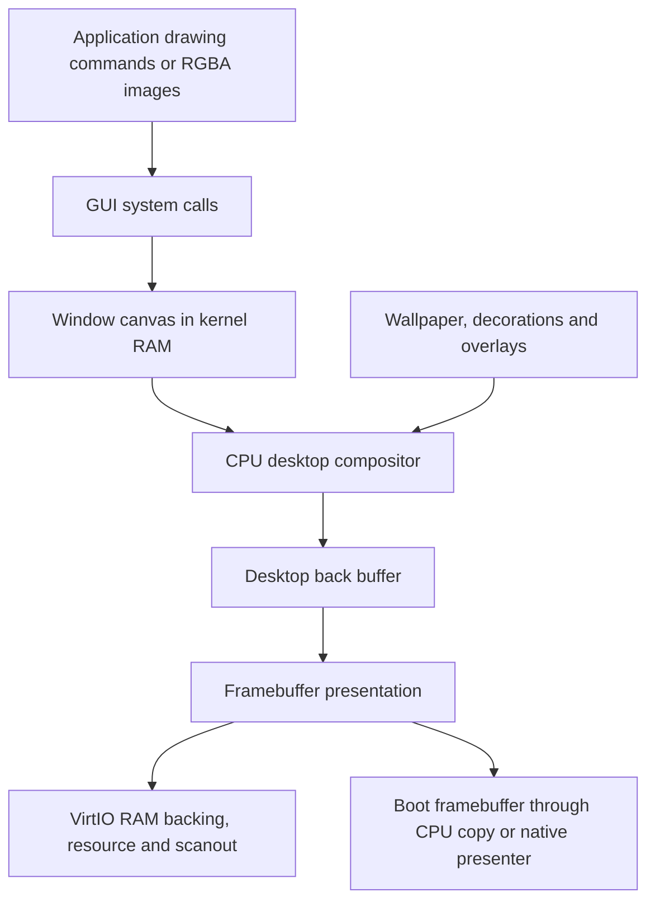

# Graphics and windowing

LogitOS runs its window manager and desktop compositor in the kernel. Applications draw into kernel-owned window canvases through GUI system calls, then report changed areas. The CPU compositor combines those canvases with wallpaper, window decorations and desktop overlays in a RAM back buffer. The framebuffer layer presents the resulting rectangles through VirtIO, CPU copies into the boot framebuffer, or a registered native GPU presenter. The main implementations are `c/kernel/gui/wm.c` and `c/kernel/gui/fb/fb.c`.

## Display path

Application drawing, desktop composition and display presentation use different buffers:

The window manager owns stacking order, window geometry and damage tracking. The framebuffer layer supplies drawing targets, coordinate conversion and presentation. Its drawing adapters use OpenLogit for software rasterization; the graphics SDK is covered in later documentation.

## Display initialization

`c/kernel/init/kmain.c` enumerates PCI devices and initializes the Page Attribute Table before calling `fb_init()`. It later initializes fonts and image codecs, calls `wm_init()`, and submits the first desktop frame through `wm_render()`. SMP startup and the device probe and binding pass follow that frame.

`fb_init()` first attempts VirtIO GPU initialization. The driver in `c/drivers/virtio/virtio_gpu.c` queries display information, allocates coherent RAM backing, creates a 2D resource, attaches its backing memory, and binds it to scanout 0. The framebuffer layer adopts the selected dimensions and uses four-byte pixels packed as `0x00RRGGBB`.

If VirtIO initialization fails, `fb_init()` reads the boot framebuffer description. It accepts an RGB framebuffer with 32 bits per pixel and preserves its pitch and channel positions. The aperture receives a writable mapping with write combining when PAT setup succeeds, or an uncached mapping as the fallback. The “uncached” description in earlier documentation refers to that fallback.

`pat_init()` in `c/kernel/cpu/power/pat.c` configures the cache type on the boot CPU before framebuffer mapping. Application processors configure the same PAT entry before becoming available for parallel copies. The framebuffer initialization log reports the mapping’s page-table cache bits; `fb_scanout_wc()` exposes the recorded result.

The boot framebuffer contract lives in `include/abi/logit_boot.h`. The entry adapter in `c/kernel/init/bootinfo.c` validates the boot block and translates native tag numbers into the internal layout consumed by the framebuffer parser. This accounts for the Multiboot names retained in `c/kernel/gui/fb/fb.c`.

The Intel, NVIDIA and AMD boot display drivers associate the boot framebuffer with a PCI device by checking that its complete physical range fits inside one of that device’s memory BARs. This lets the driver identify the adapter that owns the display on a machine with several GPUs. The checks are in `c/drivers/gpu/intel_bootfb.c`, `c/drivers/gpu/nvidia_pascal.c` and `c/drivers/gpu/amd/bootfb.c`.

## Buffers and coordinates

The retained buffers serve these roles:

| Storage | Role |
|---|---|
| A window’s `struct surface` | Application pixels, canvas dimensions and clipping rectangle. |
| `back` in `c/kernel/gui/wm.c` | Composed desktop pixels and the screen drawing target. |
| `bg` in `c/kernel/gui/wm.c` | Prepared wallpaper pixels. |
| VirtIO backing or the boot framebuffer aperture | Destination for presentation. |
| `overlay_pixels` in `c/kernel/gui/fb/fb.c` | Scratch pixels combining the CPU cursor sprite with its backdrop. |

`wm_init()` allocates `back` and `bg` from contiguous physical pages and binds `back` through `fb_set_backbuffer()`. Window creation allocates application canvases from the kernel heap. Their structures are defined in `c/kernel/gui/fb/fb.h` and `c/kernel/gui/wm_internal.h`.

Application geometry uses logical points. Canvas dimensions and compositor geometry use device pixels. During initialization, the framebuffer layer derives a scale from a design canvas of 1280 by 800 points, rounds it down to a multiple of 25 percent, and clamps the selected scale between 100 and 300 percent. Drawing handlers convert application geometry before rasterization.

For integer point rectangles, conversion uses both edges: the device width is the converted right edge minus the converted left edge. This keeps adjacent rectangles joined at fractional scales. Pointer positions use the inverse conversion before delivery to applications. Both conversions live in `c/kernel/gui/fb/fb.c`.

## Application drawing and publication

The application wrappers in `c/apps/logit.h` enter the kernel through `int $0x80`. The dispatcher in `c/kernel/exec/syscall.c` forwards GUI calls to `wm_gui_syscall()`, which resolves the caller’s application record through its current process.

`SYS_GUI_CREATE` claims a window slot, allocates its canvas, resets event and window state, and publishes the window in the stacking order. A construction state protects the slot while its canvas and metadata are being prepared.

Applications submit primitives such as rectangles and text, or pass an RGBA bitmap through `SYS_GUI_BLIT`. The handlers in `c/kernel/gui/wm.c` select the caller’s canvas and convert destination coordinates into device pixels. Bitmap submission validates the request and calls `fb_blit_user_rgba()` in `c/kernel/gui/fb/fb.c`. That function copies source rows through the user-copy interface, reusing a temporary row allocation while scaling and blending the image.

The router in `c/kernel/gui/wm_draw2.c` dispatches paths, clipping, groups, images, text and effects to their handlers. These operations share the window’s drawing target, and each surface carries its own clipping rectangle.

Flush calls finish the application’s drawing interval and queue damage for a compositor pass:

| Call | Damage reported |
|---|---|
| `SYS_GUI_FLUSH` | The whole content canvas. |
| `SYS_GUI_FLUSH_RECT` | A rectangle in content-local points. A degenerate rectangle requests the whole canvas. |

The window manager can enlarge the reported damage for effects or animated geometry. The contract is documented in `include/abi/logit_abi.h` and implemented in `c/kernel/gui/wm.c`.

The first drawing call after a flush marks the canvas as being drawn. The compositor defers damage rectangles that overlap a canvas in that state and requeues them for another pass. The retained desktop buffer supplies the previous image while the application assembles its next frame.

## Desktop composition

`wm_run()` processes input, window changes and animation, then invokes rendering when damage is pending. The damage machinery merges rectangles and expands them for effects before composition.

For an unlocked desktop, `render_layers()` rebuilds each region from the wallpaper and walks intersecting windows from back to front. Each window contributes its frame and content. If an opaque content area covers the entire region, the compositor can begin at that window and skip the covered wallpaper and lower windows.

Desktop chrome is composed after the windows: the menu bar, dock, menus, overlay panels and application switcher. `render_top()` adds the input method candidate bar, notifications and, when selected, the cursor drawn into the desktop buffer. Both functions live in `c/kernel/gui/wm.c`. While the desktop is locked, the composition path draws the greeter canvas across the screen.

Glass materials sample neighboring backdrop pixels. `dmg_expand()` grows damage to include affected glass panels and their sampling areas, then merges overlapping results. Reconstructing those areas supplies fresh backdrop pixels and prevents successive frames from repeatedly blending over earlier glass output.

Applications request glass over the desktop behind their window through `SYS_GUI_BACKDROP`. `c/kernel/gui/wm_backdrop.c` records each region and marks its canvas pixels. For a window drawn at its frame with matching canvas dimensions, composition draws the material over the underlying desktop layers, then copies application content while skipping marked pixels. Foreground drawing replaces the markers where it paints.

## Synchronization and parallel composition

Application raster operations and desktop rendering share the graphics mutex. GUI drawing calls acquire it before the window state mutex, record the drawing interval boundary, and release the state mutex during raster work. The compositor retains the graphics mutex while releasing the state mutex for its pixel pass. Canvas resizing takes the locks in the same order, preserving canvas storage while raster operations use it. `c/kernel/gui/gui_sync.h` supplies the recursive mutex wrapper backed by a sleeping kernel mutex.

Eligible frames are divided into horizontal bands. The compositor thread and kernel worker threads claim bands and render desktop layers into the shared back buffer. Workers have their own drawing contexts, target bookkeeping, clip stacks and graphics scratch storage.

The splitter in `c/kernel/gui/wm_bands.h` keeps glass sampling extents within a band. A worker can then reconstruct the backdrop needed by its glass operations within the area it owns. Bands intersecting the dock or application switcher run on the compositor thread because icon drawing can access the filesystem. After the layer work completes, that thread draws the top overlays and presents the rectangles.

## Presentation

`fb_present_rect()` in `c/kernel/gui/fb/fb.c` clamps a rectangle to the display and selects its presentation path.

| Path | Operation |
|---|---|
| VirtIO | Copy the rectangle into the driver’s RAM backing, then call `virtio_gpu_flush()`. |
| CPU boot framebuffer | Copy rows into the mapped framebuffer aperture, respecting its pitch. |
| Native presenter | Pass the desktop back buffer and rectangle to a synchronous driver callback. |

VirtIO presentation submits `GPU_CMD_TRANSFER_TO_HOST_2D`, followed by `GPU_CMD_RESOURCE_FLUSH`, in `c/drivers/virtio/virtio_gpu.c`.

The x86-64 CPU row copy uses `rep movsb`. Tall rectangles can use the parallel copy helper in `c/kernel/cpu/smp/smp.c`. Its timeout policy disables parallel presentation after four consecutive acknowledgement timeouts, or eight timeouts within a full window of 64 presentations. The presenting CPU claims pending bands for fallback copies and waits for bands already executing before completing the operation. The policy is defined in `c/kernel/cpu/smp/present_policy.c`.

Before invoking a native presenter, the framebuffer layer blocks new CPU writes to the presentation destination and waits for existing writers to finish. The callback contract requires `0` for completed presentation and `-1` when CPU fallback is safe.

The RV100 presenter registered by `c/drivers/gpu/amd/accel.c` uses `c/drivers/gpu/amd/rv100/engine.c`. Solid rectangles use a GPU fill. Other rectangles are uploaded into VRAM staging storage and copied by the engine into scanout. The desktop pixels supplied to the presenter are composed on the CPU in both cases.

## Pointer paths

The window manager selects a pointer path during initialization:

| Path | Pointer update |
|---|---|
| VirtIO cursor plane | Define a 64 by 64 ARGB resource and move it through the cursor queue. |
| CPU scanout overlay | Restore the old rectangle from the desktop back buffer and present the sprite at its new position. |
| Composited cursor | Draw the sprite into the desktop back buffer during composition. |

VirtIO cursor movement uses a queue command and avoids desktop recomposition. The cursor interface is implemented in `c/drivers/virtio/virtio_gpu.c`.

For a boot framebuffer using CPU presentation, `c/kernel/gui/fb/fb_overlay.c` blends the sprite with backdrop pixels copied from RAM into scratch storage. Presentation substitutes those scratch pixels where the cursor intersects the rectangle being copied. The desktop back buffer keeps only the scene, so a move can restore the previous location from RAM.

`wm_pointer_sync()` in `c/kernel/gui/wm.c` publishes the final pointer position and shape after an input batch. Its caller holds the graphics and window state locks in the same order used for application drawing.

## Events and resizing

Keyboard and mouse callbacks enqueue input for the window manager. Its main loop drains the queue, updates focus and pointer capture, handles window controls, and routes application events. Each window has an event ring and a wait queue. Applications can poll or sleep through `SYS_WAIT_EVENT`. The interfaces are declared in `c/kernel/gui/wm.h` and implemented in `c/kernel/gui/wm.c`.

During resizing, the frame follows the pointer while the compositor stretches the available canvas into that frame. Canvas updates are throttled during the drag. When an update succeeds, `win_apply_size()` reshapes or replaces the canvas before sending `EV_RESIZE` with the new content dimensions in points.

## Diagnostics

After the first desktop frame, `fb_present_bench()` reports pixel routine checks and timings. On the CPU boot framebuffer path, it also measures one full-screen copy. These boot diagnostics are implemented in `c/kernel/gui/fb/fb.c`.

Once a scheduler thread exists, slow-frame diagnostics record elapsed time, compositor thread CPU time, graphics mutex wait, layer rendering, top overlays, presentation and glass work. Glass time overlaps layer time. Frames taking at least 33 ms contribute to the slow-frame count and worst-frame record; serial reporting is limited to one line per second. `c/kernel/gui/wm_trace.c` implements the recording and reporting policy, and `wm_render()` prints its snapshot after releasing both locks.

With `HWHUD=1`, `c/kernel/diag/hwhud.c` draws a hardware panel into the back buffer after desktop composition and presents its rectangle. When system overlays appear, the panel requests repainting of the area it covered. The same build option enables the Polaris display survey and gated boot self-test reached through `c/drivers/gpu/amd/bootfb.c`.

## Limitations

- Display state has one global width and height. The VirtIO driver binds scanout 0 and selects its dimensions during initialization.
- Each application record carries one window index. The shared window table has `MAXWIN` set to 16 in `c/kernel/gui/wm_internal.h`.
- Each application window has one canvas. After the 400 ms deadline defined by `WM_MIDFRAME_MAX_MS`, the compositor may show an unfinished canvas to allow pending damage to progress.
- Intel and NVIDIA use the boot framebuffer for desktop presentation. The Polaris boot self-test runs in `POLARIS_DESKTOP_MODE_SELF_TEST`, which keeps CPU presentation; the presentation startup interface in `c/drivers/gpu/amd/polaris/desktop.c` has test callers only.
- A native presentation result below `-1` quarantines framebuffer writes until reboot because GPU completion may be uncertain.
- Backdrop foreground edges blend against the region’s fill color. Resizing, scaled windows and fading windows have reduced backdrop behavior, described in `c/kernel/gui/wm_backdrop.c`.
- VirtIO framebuffer captures omit the pointer when it uses the cursor plane, as documented in `c/drivers/virtio/virtio_gpu.h`.
- The PAT mapping and CPU cursor overlay sources mark X79-VG4 hardware verification as pending.

## See also

- [GPU drivers](../drivers/gpu.md)
- [Window manager](../kernel/window-manager.md)
- [Compositing and effects](../kernel/compositing-and-effects.md)
- [GUI events, clipboard and notifications](../kernel/gui-events-and-services.md)
- [Text and input](text-and-input.md)
- [System calls](system-calls.md)

## Source map

| File | What it contains |
|---|---|
| `c/kernel/init/kmain.c` | Display initialization, first frame, SMP startup and driver binding order. |
| `include/abi/logit_boot.h`, `c/kernel/init/bootinfo.c` | Boot framebuffer contract and tag normalization. |
| `c/kernel/cpu/power/pat.c` | PAT setup for framebuffer write combining. |
| `c/kernel/gui/fb/fb.c`, `c/kernel/gui/fb/fb.h` | Surfaces, scaling, drawing targets, presentation, cursor selection and boot diagnostics. |
| `c/kernel/gui/fb/fb_overlay.c`, `c/kernel/gui/fb/fb_overlay.h` | CPU cursor overlay geometry and composition from RAM. |
| `c/drivers/virtio/virtio_gpu.c`, `c/drivers/virtio/virtio_gpu.h` | VirtIO display resources, backing memory, rectangle transfers and cursor plane. |
| `c/drivers/gpu/intel_bootfb.c`, `c/drivers/gpu/nvidia_pascal.c` | Intel and NVIDIA boot framebuffer ownership checks. |
| `c/drivers/gpu/amd/bootfb.c` | AMD boot framebuffer ownership, Polaris resource discovery and diagnostic startup. |
| `c/drivers/gpu/amd/accel.c`, `c/drivers/gpu/amd/rv100/engine.c` | RV100 presenter registration, uploads, fills, copies and completion handling. |
| `c/drivers/gpu/amd/polaris/desktop.c`, `c/drivers/gpu/amd/polaris/selftest/selftest.c` | Polaris runtime startup modes and boot self-test integration. |
| `c/kernel/gui/wm.c`, `c/kernel/gui/wm_internal.h`, `c/kernel/gui/wm.h` | Windows, canvases, damage, composition, input, GUI calls and resizing. |
| `c/kernel/gui/wm_bands.h` | Composition band splitting around glass sampling extents. |
| `c/kernel/gui/wm_draw2.c`, `c/kernel/gui/wm_backdrop.c` | Drawing dispatch and application backdrop regions. |
| `c/kernel/gui/gui_sync.h` | GUI synchronization primitives. |
| `c/kernel/cpu/smp/smp.c`, `c/kernel/cpu/smp/present_policy.c` | Parallel framebuffer copies and timeout policy. |
| `c/kernel/gui/wm_trace.c`, `c/kernel/gui/wm_trace.h` | Slow-frame records and serial reporting policy. |
| `c/kernel/diag/hwhud.c`, `Makefile` | Hardware panel implementation and build option. |
| `c/kernel/exec/syscall.c`, `include/abi/logit_abi.h` | GUI syscall routing and application ABI contracts. |
| `c/apps/logit.h` | Application drawing, flush and event wrappers. |
