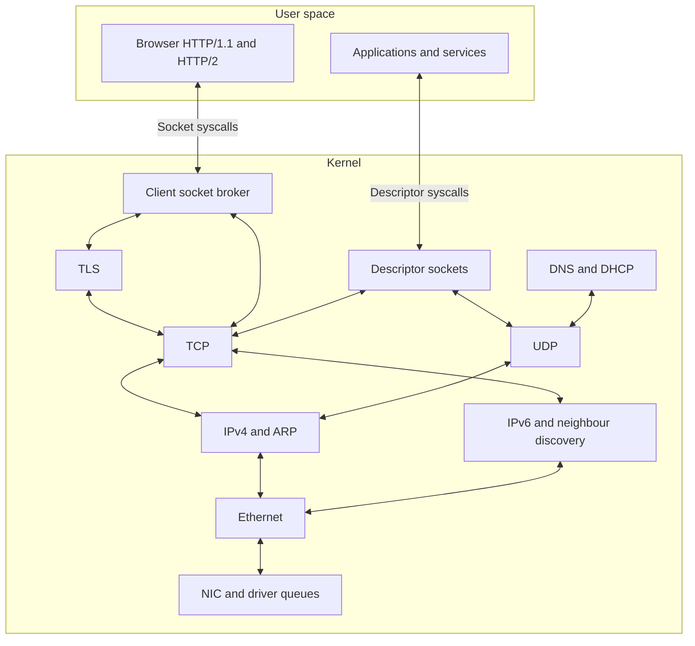

# Network stack

LogitOS carries Ethernet frames from NIC drivers through IPv4 or IPv6 into transport buffers and socket interfaces. TCP, UDP, DHCP, DNS, and TLS run in the kernel. The browser runs its HTTP/1.1 and HTTP/2 clients in user space. Receive processing and TCP timers share a network softirq; boot code and thread calls advance configuration, name resolution, connection setup, and TLS. The main integration points are `c/drivers/net/netdev.c` and `c/net/core/net.c`.

## Layers and interfaces

| Layer | Responsibility | Implementation |
|---|---|---|
| NIC | DMA buffers, descriptor queues, transmission, interrupt acknowledgement | `c/drivers/net/`, `c/drivers/virtio/virtio_net.c` |
| Ethernet | Frame validation, destination filtering, VLAN tag removal, frame construction and padding | `c/net/link/eth.c` |
| IPv4 | Datagram validation, routing, fragment reassembly, ARP resolution | `c/net/ip/ip.c`, `c/net/ip/reasm.c`, `c/net/core/route.c`, `c/net/link/arp.c` |
| IPv6 | Address configuration, source selection, packet delivery, neighbour discovery | `c/net/ip/ip6.c`, `c/net/ip/ip6_addr.c`, `c/net/ip/nd.c` |
| Transport | TCP streams and listeners; UDP datagram queues | `c/net/transport/tcp.c`, `c/net/transport/udp.c` |
| Kernel services | DHCP, DNS, socket management, TLS | `c/net/core/`, `c/net/dns/`, `c/net/tls/` |
| Browser protocols | HTTP parsing, connection pooling, HTTP/2 streams and header compression | `c/net/http/`, `c/apps/gui/browser/app/runtime.c` |

The diagram shows the network data paths. The client broker manages outgoing TCP connections with optional TLS. Descriptor sockets connect transports to file operations.

DNS sends queries over IPv4 UDP and uses IPv4 TCP when a reply carries the truncation flag. DHCP also uses IPv4 UDP. Their polling functions consume transport data and advance their state in `c/net/dns/dns.c` and `c/net/core/dhcp.c`.

## Devices and configuration

`struct netdev` describes a driver's callbacks and hardware identity. Its receive callback supplies an Ethernet frame whose buffer remains valid for the duration of the call. `struct netif` holds the stack's interface name, index, flags, MAC address, and IPv4 address list. This division lets routing refer to an interface while the driver owns device queues. Both structures are defined in `c/drivers/net/netdev.h`.

`netdev_init()` registers loopback, then probes PCI devices in driver priority order. The list includes VirtIO, Intel, Realtek, and PCnet drivers. Successful probes publish their device interface through the device model; the first registered NIC becomes primary. Receive polling visits every registered device with a receive callback. See `c/drivers/net/netdev.c`.

`net_init()` copies the primary MAC address, registers `SOFTIRQ_NET`, requests receive interrupt callbacks, and calls `net_cfg_acquire()`. Static configuration takes priority when automatic configuration is disabled. Otherwise, the stack attempts DHCP.

The fallback policy moved from `c/net/core/net.c` into `c/net/core/netcfg.c`. After a failed boot DHCP attempt, a hypervisor feature check selects the QEMU user-networking defaults: address 10.0.2.15, mask 255.255.255.0, gateway 10.0.2.2, and resolver 10.0.2.3. With that feature clear, the initial IPv4 configuration remains zero while background DHCP acquisition continues.

DHCP gives the link wait and initial exchange a shared four-second monotonic deadline. The exchange budget is 300 ticks, about three seconds, capped by the time remaining after the link wait. Background acquisition uses retransmission delays of 4, 8, 16, 32, then 64 seconds, with jitter of up to one second in either direction. Link recovery starts INIT-REBOOT for a remembered lease or DISCOVER for an unconfigured client. See `c/net/core/dhcp.c`.

Lease publication takes `net_lock()`, keeping the address, mask, gateway, and resolver updates together with respect to packet processing. A background lease that changes the address triggers an ARP announcement. A matching DHCPNAK received during a request clears the IPv4 configuration, flushes the primary interface's routes, and starts a new DISCOVER transaction. This withdraws the refused address while acquisition continues.

Boot calls `net_init()` before `smp_init()`. During SMP setup, after APIC initialization, `netdev_irq_route()` requests each NIC's interrupt route through the device model. Devices with `msi_ok` set request MSI with INTx fallback; the others request INTx. The receive callback is enabled after successful routing. Boot DHCP advances reception through `net_poll()` before these routes exist. See `c/kernel/init/kmain.c`, `c/kernel/cpu/smp/smp.c`, `c/drivers/net/netdev.c`, and `c/kernel/pci/pci_msi.c`.

The Realtek driver publishes link changes through `netdev_set_link()` during receive polling and link-change interrupts. Its `link_info` callback reads cached speed and duplex information. Startup prepares the controller before reset, configures the MAC and PHY, and publishes descriptor addresses before enabling transmission and reception. See `c/drivers/net/rtl8169.c`.

IPv6 begins through `ip6_poll()`, reached from the IP maintenance hook. It derives a link-local address from the MAC address, performs Duplicate Address Detection, and solicits routers. Router advertisements provide prefixes for SLAAC and default-router information. Maintenance also advances address lifetimes and neighbour state in `c/net/ip/ip6.c` and `c/net/ip/nd.c`.

## Receiving a packet

A received TCP segment follows these stages:

1. The NIC completes a receive buffer. Its interrupt handler acknowledges the device and calls `net_rx_schedule()`.
2. The scheduling function raises `SOFTIRQ_NET`. If a previous receive drain is still owed, it drains inline.
3. A receive drain calls `netdev_rx_poll(eth_input)`. NIC drivers invoke the callback while holding the network lock.
4. Ethernet validates the frame, checks its destination, removes supported VLAN tags, and dispatches by EtherType.
5. IP validates the datagram and delivers its transport payload. TCP checks the segment, updates connection state, copies received bytes into transport storage, and wakes waiting threads.

The scheduling code is in `c/net/core/net.c`. Packet delivery runs through `c/net/link/eth.c`, `c/net/ip/ip.c`, `c/net/ip/ip6.c`, and `c/net/transport/tcp.c`.

Softirq execution depends on the interrupt entry path. At the common exit in `interrupt_handler()`, an entry with no enclosing kernel entry runs pending softirqs after interrupt acknowledgement. Device-model vectors use `irq_isr_entry()`, which dispatches the handler, acknowledges the interrupt, and restores entry depth. Pending work can then run at a later eligible common entry, such as a timer interrupt. These paths are implemented in `c/kernel/cpu/irq/interrupts.c` and `c/drivers/core/irq.c`.

VirtIO illustrates buffer ownership. `vnet_rx_poll()` completes DMA ownership, skips the VirtIO packet header, invokes the receive callback, and reposts the buffer. A drain has a budget equal to the posted receive-buffer count, bounding work even when packets continue arriving. See `c/drivers/virtio/virtio_net.c`.

Transport storage preserves data after the callback returns. TCP copies stream bytes into its receive storage. UDP copies accepted datagrams into queues with the sender address and port. IPv4 fragments pass through `reasm_input()` before transport dispatch; the completed datagram's storage is released after delivery. See `c/net/transport/tcp.c`, `c/net/transport/udp.c`, and `c/net/ip/reasm.c`.

For a browser TLS connection, a later broker read calls `tls_recv()` in thread context. TLS consumes TCP bytes, authenticates and decrypts records, and returns plaintext. The syscall copies that plaintext to user space, where the browser's transport callback feeds HTTP processing. See `c/net/core/sock.c`, `c/net/tls/tls.c`, `c/kernel/exec/syscall.c`, and `c/apps/gui/browser/app/runtime.c`.

## Sending a packet

A browser request begins in user-space HTTP code. The socket syscall copies user bytes into kernel storage, then `sock_send()` queues accepted bytes in the broker handle. A ready handle can flush immediately; subsequent `sock_pump()` calls continue through `tls_send()` or `tcp_send_nb()`. TLS seals plaintext into records before passing bytes to TCP. See `c/kernel/exec/syscall.c`, `c/net/core/sock.c`, and `c/net/tls/tls.c`.

TCP copies accepted bytes into its send ring. Output considers the peer's receive window, congestion window, segment size, and Nagle processing. ACK handling and timer passes can release further output. Congestion control, retransmission deadlines, fast recovery, and selective acknowledgement tracking live in `c/net/transport/tcp.c`.

For IPv4 unicast, `ip_send()` synchronizes routes with the current configuration and looks up the destination. Selection prefers the longest matching prefix, then the lower metric, then earlier insertion. The result supplies the next hop and source address. `arp_output()` sends through a known neighbour binding or queues the completed datagram behind an active ARP lookup. Queuing preserves the initial packet while address resolution completes. See `c/net/ip/ip.c`, `c/net/core/route.c`, and `c/net/link/arp.c`.

IPv6 output chooses a source address and next hop, resolves unicast neighbours through ICMPv6, and constructs the packet in `c/net/ip/ip6.c`.

Both address families reach `eth_send()`. It constructs the Ethernet header, pads short frames with zero bytes, and calls the NIC transmit interface. Frames addressed to the machine's MAC enter a local queue. Deferred delivery lets TCP publish its sequence and connection state before a local response reaches the receive path. See `c/net/link/eth.c` and `c/net/core/net.c`.

The VirtIO transmitter copies the frame behind its device header, publishes the DMA descriptor, and notifies the transmit queue. Later sends reclaim completed transmit buffers. See `c/drivers/virtio/virtio_net.c`.

## Sockets, TLS, and HTTP

LogitOS exposes two socket interfaces:

| Interface | Ownership | Progress and waiting |
|---|---|---|
| Client broker | Handle checked against the owning process ID | Calls queue or consume available bytes; `sock_pump()` advances connection phases |
| Descriptor sockets | `F_SOCK` file description referenced by process descriptors | File operations dispatch to socket backends; TCP waits use transport wait queues |

The broker advances through DNS resolution, neighbour preparation, TCP establishment, optional TLS handshake, and readiness. DNS supplies an ordered list of IPv4 and IPv6 candidates. When both families are available, the broker can start an attempt through the other family after a 250 ms head start. See `c/net/core/sock.c` and `c/net/dns/dns.c`.

The descriptor backend supports IPv4 TCP streams, UDP datagrams, raw ICMP, and Unix sockets. Accepted TCP connections receive file descriptions, so file reference management governs their lifetime. TCP listeners, TCP connections, and Unix sockets expose polling hooks. The backend is in `c/net/core/lsock.c`; file dispatch and descriptor installation are in `c/kernel/exec/fd/file.c` and `c/kernel/exec/syscall.c`.

TLS sessions refer to TCP connection IDs. `tls_start()` checks RNG strength and creates a session; `tls_step()` advances the handshake as transport bytes and buffer space become available. The client implements TLS 1.3 and TLS 1.2, reports ALPN selection, and checks certificate paths against the requested hostname, supplied time, and trust roots. See `c/net/tls/tls.c`, `c/net/tls/tls12.c`, and `c/net/tls/x509.c`.

The browser adapts socket reads and writes to HTTP transport callbacks. Connection pooling keys reuse by host, port, and TLS mode. HTTP/2 keeps stream state and HPACK encoder and decoder contexts per connection. `Makefile` includes these modules in the browser's user-space build; their integration is in `c/apps/gui/browser/app/runtime.c`.

The older kernel API in `c/net/http/http.c` performs a synchronous fetch inside `http_get()`, using shared response state protected by a service mutex. The description in `c/net/http/http.h` still describes an asynchronous fetch advanced by `http_poll()`; the current implementation completes the fetch in `http_get()` and leaves `http_poll()` empty.

## Execution and locking

Receive processing and TCP deadlines share `SOFTIRQ_NET`. A periodic 10 ms kernel timer records that a TCP pass is due and raises the softirq. The handler drains receive queues before calling `tcp_poll()`, allowing an arriving ACK to cancel a pending retransmission. Every network softirq invocation drains receive queues, so the timer also supplies receive progress during NIC interrupt silence. See `c/net/core/net.c`.

`net_poll()` provides another receive drain and consumes an owed TCP timer pass. It then advances fragment expiry, IPv6 maintenance, ARP, DHCP, DNS, and client sockets. DNS precedes the broker so a completed lookup can advance its connection in the same pass. The window-manager loop calls `net_poll()` during fetches as well; blocking network helpers also call it while waiting. See `c/net/core/net.c` and `c/kernel/gui/wm.c`.

Pending softirq bits belong to each CPU. `softirq_run_pending()` processes up to eight rounds, retaining further work for a later entry. Nested entries defer execution to the enclosing common entry. The inline receive fallback and polling provide additional progress during kernel operations that enable interrupts. See `c/kernel/sync/work.c` and `c/net/core/net.c`.

| Lock | Protected state or operation | Implementation |
|---|---|---|
| `net_lock()` | Packet processing, transport storage, neighbour state, NIC queue access | `c/net/core/netlock.c` |
| `struct io_domain` | Broker, DNS, DHCP, TLS, and kernel HTTP service operations | `c/drivers/core/io_domain.h` and service implementations |
| Descriptor slot gate and per-socket control mutex | Socket allocation and control transactions | `c/net/core/lsock.c` |
| Route gate using `io_lock_t` | Route lookup and table updates | `c/net/core/route.c` |

`net_lock()` saves local interrupt state and serializes CPUs with a spinlock. Recursion follows the owning CPU because receive processing can generate an ACK or ARP response and enter transmit code before returning. Service mutex recursion follows the calling thread, allowing ownership to survive scheduling and migration.

The service acquisition order is broker, then DNS or TLS, then transport locking. Blocking DNS and TLS wrappers pump the network between service operations, after releasing service ownership. TCP waits park outside the network lock. Their predicates inspect readiness fields under the wait-queue lock, preserving the order from packet processing into wakeups. See `c/net/core/sock.c`, `c/net/dns/dns.c`, `c/net/tls/tls.c`, and `c/net/transport/tcp.c`.

Older comments in `c/net/core/net.c` and `c/kernel/sync/work.c` describe execution under a big kernel lock. The correction in `c/kernel/cpu/irq/interrupts.c` records that kernel entries permit concurrent CPUs and rely on object locks.

## Diagnostics

Receive counters distinguish scheduled NIC interrupts, softirq drains, inline drains, and polling drains. `net_rx_poll_active()` reports polling when interrupt routing is absent, or after at least four unannounced frames and more than 100 ms of interrupt silence. A call to `net_rx_schedule()` resets the unannounced-frame count. See `c/net/core/net.c`.

The Realtek interrupt handler masks device interrupts after more than 50,000 entries in its one-second counting window, preserving polling progress. See `c/drivers/net/rtl8169.c`.

`make HWHUD=1` enables the hardware panel. Its network display combines link speed and duplex, IPv4 configuration, DHCP state and retry timing, frame counters, interrupt counts, and the polling indicator. The build switch is in `Makefile`; the display reads the driver and network status interfaces in `c/kernel/diag/hwhud.c`.

## Limitations

- IPv4 route selection records an output interface, but ARP and Ethernet output still use the primary NIC. Ethernet destination filtering and IPv4 receive addressing also use the global configuration. See `c/drivers/net/netdev.h`, `c/net/link/eth.c`, and `c/net/ip/ip.c`.
- IPv6 input dispatches TCP and ICMPv6. IPv6 UDP and fragment reassembly are absent. See `c/net/ip/ip6.c`.
- Fixed pools provide 32 TCP connections, 16 broker handles, 16 TLS sessions, and eight UDP sockets. Each UDP socket queues four datagrams. See `c/net/transport/tcp.c`, `c/net/core/sock.c`, `c/net/tls/tls.h`, and `c/net/transport/udp.c`.
- Descriptor UDP and raw sockets lack readiness hooks. The libc IPv4 `socket()` wrapper accepts TCP streams. See `c/net/core/lsock.c` and `c/apps/libc/src/socket.c`.
- DNS uses one configured upstream resolver and has no iterative resolution or DNSSEC validation. See `c/net/dns/dns.c`.
- Drivers that leave link state unpublished retain the optimistic running flag assigned during PCI NIC registration. DHCP follows the primary interface's reported state. See `c/drivers/net/netdev.h` and `c/net/core/dhcp.c`.
- The Realtek driver accepts MAC versions 40, 42, and 44 and loads no external PHY firmware. Its startup programs and interrupt delivery remain unverified on X79-VG4 hardware according to `c/drivers/net/rtl8169.c`, `c/drivers/net/rtl8168_id.c`, `c/drivers/net/rtl8168_hw.c`, and `c/drivers/net/rtl8168_phy.c`.
- Failure to register the TCP timer restores timer progress through `net_poll()` and emits a diagnostic. See `c/net/core/net.c`.
- The network, TLS, and cryptographic implementations are experimental. Test results establish behavior in their named environments, not full standards compliance or production security. See `TRANSPARENCY.md`.

## See also

- [Ethernet drivers](../drivers/network.md)
- [VirtIO drivers](../drivers/virtio.md)
- [Sockets](../networking/sockets.md)
- [Link layer, IPv4 and IPv6](../networking/link-and-ip.md)
- [TCP and UDP](../networking/tcp-udp.md)
- [DNS](../networking/dns.md)
- [TLS and certificates](../networking/tls.md)
- [HTTP](../networking/http.md)

## Source map

| File | What it contains |
|---|---|
| `c/drivers/net/netdev.h`, `c/drivers/net/netdev.c` | Driver callbacks, interfaces, probing, link reporting, interrupt registration, and transmission |
| `c/drivers/virtio/virtio_net.c` | DMA buffer ownership, receive drains, transmit publication, and completion handling |
| `c/drivers/net/rtl8169.c` | Realtek initialization, packet queues, link reporting, MSI preference, and interrupt storm guard |
| `c/drivers/net/rtl8168_id.c`, `c/drivers/net/rtl8168_hw.c`, `c/drivers/net/rtl8168_phy.c` | Realtek MAC identification and MAC/PHY startup programs |
| `c/kernel/init/kmain.c`, `c/kernel/cpu/smp/smp.c` | Network initialization order and interrupt routing |
| `c/kernel/pci/pci_msi.c`, `c/drivers/core/irq.c` | Device interrupt selection, dispatch, and dynamic vector entry |
| `c/net/core/net.c`, `c/net/core/netcfg.c` | Receive scheduling, local delivery, TCP timer integration, polling, and boot configuration policy |
| `c/net/core/netlock.c` | Recursive network lock and ownership checks |
| `c/net/link/eth.c`, `c/net/link/arp.c` | Ethernet processing, local delivery, IPv4 neighbour resolution, and queued datagrams |
| `c/net/core/route.c` | IPv4 route storage, synchronization, and lookup ranking |
| `c/net/ip/ip.c`, `c/net/ip/reasm.c` | IPv4 input and output, route synchronization, fragment reassembly, and maintenance |
| `c/net/ip/ip6.c`, `c/net/ip/ip6_addr.c`, `c/net/ip/nd.c` | IPv6 packets, address selection and configuration, ICMPv6, and neighbour discovery |
| `c/net/transport/tcp.c`, `c/net/transport/udp.c` | Transport state, buffers, listeners, timers, and datagram queues |
| `c/net/core/dhcp.c`, `c/net/dns/dns.c` | DHCP acquisition and renewal; DNS queries and TCP fallback |
| `c/net/core/sock.c`, `c/net/core/lsock.c` | Client broker and descriptor socket backend |
| `c/net/tls/tls.c`, `c/net/tls/tls12.c`, `c/net/tls/tls.h`, `c/net/tls/x509.c` | TLS sessions, handshakes, records, limits, and certificate verification |
| `c/net/http/http.c`, `c/net/http/http.h` | Synchronous kernel HTTP implementation and its older interface description |
| `c/net/http/http1.c`, `c/net/http/http2.c`, `c/net/http/hpack.c`, `c/net/http/hpool.c` | HTTP clients, header compression, and connection pooling |
| `c/apps/gui/browser/app/runtime.c`, `Makefile` | Browser transport integration and user-space protocol build inputs |
| `c/kernel/exec/syscall.c`, `c/kernel/exec/fd/file.c`, `c/apps/libc/src/socket.c` | Socket syscalls, file dispatch, and libc wrappers |
| `c/kernel/sync/work.c`, `c/kernel/cpu/irq/interrupts.c` | Softirq scheduling and common kernel entry and exit |
| `c/kernel/gui/wm.c`, `c/kernel/diag/hwhud.c` | Desktop network polling and hardware-panel diagnostics |
| `c/drivers/core/io_domain.h`, `c/drivers/core/io_lock.h` | Service mutexes and short object gates |
| `TRANSPARENCY.md` | Evidence requirements and scope of network and security claims |