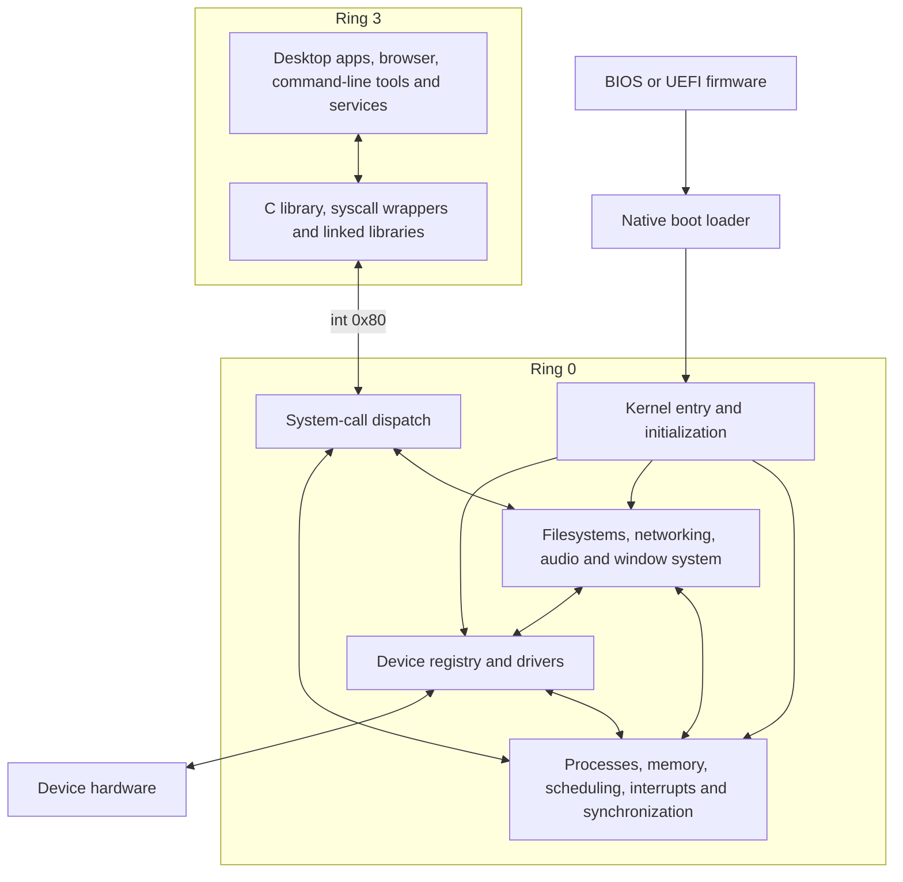

# Architecture overview

LogitOS is an experimental x86-64 operating system with native BIOS and UEFI loaders, a monolithic kernel, and applications running in ring 3. The kernel contains memory management, scheduling, drivers, filesystems, networking, audio mixing and window composition. Each process has an address space and accesses kernel facilities through the LogitOS syscall ABI. The main integration points are `c/kernel/init/kmain.c`, `c/kernel/exec/syscall.c` and the shared contracts under `include/abi/`.

## Layers and privilege boundaries

Kernel components communicate through function calls, shared objects and operation tables. Applications cross the privilege boundary through system calls. The wrappers in `c/apps/logit.h` and the C library’s I/O layer in `c/apps/libc/src/io.c` expose this interface.

Runtime placement follows the source selections and link rules in `Makefile`. TCP and TLS compile into the kernel. The browser links HTTP framing, connection pooling and HTTP/2 into its application image, while the kernel retains HTTP code for its own consumers. Libraries under `c/lib/` have both kernel and application consumers, so their execution privilege follows the binary that links them.

## From firmware to the desktop

The BIOS loader starts in `c/boot/bios/preload.asm` and continues in `c/boot/bios/loader.asm`. The UEFI loader resides in `c/boot/efi/loader.c`. Both load the kernel’s ELF segments and enter it in 64-bit long mode using `include/abi/logit_boot.h`. The boot block supplies a firmware memory map and tags describing the framebuffer and available ACPI information.

UEFI can also supply SMBIOS copies, a display report and named boot modules. Its display selector uses the preferred progressive geometry from a valid EDID when available, then an offered mode with a similar aspect ratio, then the largest supported 32-bit mode (`c/boot/efi/gop_pick.c`). A handoff stub placed below 1 GiB remains reachable during the switch to the initial kernel page tables. The kernel records boot-module reservations before physical memory initialization releases available RAM (`c/boot/efi/loader.c`, `c/kernel/init/bootmod.c`, `c/kernel/mm/phys/pmm.c`).

The common entry in `c/boot/long.asm` establishes the kernel stack and CPU state. `c/kernel/init/bootinfo.c` validates the native boot block and adapts its tags for existing kernel consumers. This concentrates interpretation of the loader contract at kernel entry.

`kernel_main()` brings up interrupt handling and physical memory, then initializes diagnostics, PCI discovery, storage, the root filesystem, networking and the desktop. Dependencies determine the order: page-cache accounting exists before memory pressure can trigger reclaim, its VFS adapter is installed after the root mount attempt, and the general driver binding pass follows APIC setup. Storage and networking have earlier bootstrap paths (`c/kernel/init/kmain.c`).

Startup continues in `wm_run()`. It initializes scheduling, releases waiting application processors, selects the greeter or desktop from account state, and starts the console login process. Its loop also supervises the agent broker (`c/kernel/gui/wm.c`).

## Processes and the kernel interface

A process holds its address-space identity, descriptor table, working directory and capability state. A window association connects graphical applications to the same process machinery used by command-line programs. User threads share the process object and address space while retaining their own kernel stacks, saved execution state and thread-local storage (`c/kernel/exec/proc.h`, `c/kernel/sched/uthread.h`).

The syscall convention places the number and return value in `rax`, with arguments in `rdi`, `rsi` and `rdx`. Applications enter through `int 0x80`. Interrupt handling forwards calls to the dispatcher, which applies capability and worker-policy checks and routes operations to subsystem implementations (`include/abi/logit_abi.h`, `c/kernel/cpu/irq/interrupts.c`, `c/kernel/exec/syscall.c`).

User-memory copies proceed a page at a time under the address-space guard. Each accessed frame receives a reference and a pin for the duration of the copy. This keeps the physical memory valid while other threads change mappings (`c/kernel/exec/usercopy.c`, `c/kernel/mm/virt/vmm.c`).

Native AEX packages contain metadata and an ELF image. Keeping ELF inside the container lets AEX reuse executable validation and segment loading. Supported bare ELF images enter the same loading machinery (`c/kernel/exec/load/aex.h`, `c/kernel/exec/load/aex.c`, `c/kernel/exec/load/elf.c`).

## Memory, scheduling and interrupts

Memory management divides responsibility among physical-frame allocation, the kernel heap, page tables, virtual-area tracking and fault handling. A supervisor physical map gives the kernel access to usable RAM beyond the loader’s initial identity mapping. User-address validation recognizes a legacy application window and a wider window, with each accepted range fitting wholly within one window (`c/kernel/mm/phys/physmap.h`, `c/kernel/mm/mm.h`).

Page faults supply anonymous memory, resolve copy on write, restore swapped pages and populate mappings from files. The file page cache holds physical frames that processes can map. Reclaim can discard eligible cached file pages and recover their contents through later reads; swap supplies backing for other eligible pages (`c/kernel/mm/virt/fault.c`, `c/kernel/mm/cache/pcache.h`, `c/kernel/mm/reclaim/reclaim.c`, `c/kernel/mm/reclaim/swap.c`).

The scheduler charges execution time according to thread weight and selects eligible threads with the smallest virtual time. Blocking parks a thread until a wakeup or deadline makes it ready. Wait queues coordinate enrollment, condition checks and sleeping so an event arriving during that transition can wake the waiter (`c/kernel/sched/sched.c`, `c/kernel/sync/wait.c`).

ACPI discovery and APIC initialization supply processor information and interrupt routing for multiprocessor startup. Kernel paths can execute concurrently across CPUs, with subsystem and object locks protecting shared state. Interrupt entry tracks nesting; timer handling advances time and expires scheduler waits. Pending softirqs run on the kernel exit path, while queued work that can sleep executes in a kernel worker thread (`c/kernel/cpu/smp/smp.c`, `c/kernel/cpu/irq/interrupts.c`, `c/kernel/sync/work.c`).

## Devices and storage

PCI enumeration populates a device registry. Drivers provide match tables and probe callbacks; the binding pass assigns each device to the first matching driver whose probe succeeds. Resource mapping and interrupt allocation are shared services. PCI interrupt requests can use MSI-X, MSI or INTx, and AML initialization enables a later pass over existing INTx routes using firmware routing information (`c/drivers/core/driver.h`, `c/drivers/core/device.c`, `c/kernel/pci/pci_msi.c`, `c/kernel/pci/pci_prt_aml.c`).

Storage connects several interfaces:

| Interface | Responsibility |
|---|---|
| Process descriptor table → open file description | Descriptor ownership and shared file lifetime |
| Open file description → backend | Reads, writes and readiness for files, pipes, terminals, sockets and events |
| VFS → filesystem | Path resolution, mount selection, permissions and filesystem operations |
| LogitFS → block cache | Filesystem blocks and transaction write ordering |
| Block layer → controller driver | Requests, partition offsets and controller operations |

These interfaces are implemented in `c/kernel/exec/fd/file.c`, `c/fs/vfs/vfs.c`, `c/fs/vfs/vfs_path.c`, `c/fs/logitfs/logitfs.c`, `c/fs/cache/bcache.c` and `c/drivers/block/blkdev.c`.

The block layer supports several outstanding requests when a driver supplies queue capacity. It serializes overlapping requests involving a write and treats flushes as queue fences. Block-cache synchronization submits dirty blocks in bounded batches. AHCI uses native command queuing when controller and disk capabilities permit it, with late MSI attachment and polling fallback (`c/drivers/block/blkdev.c`, `c/fs/cache/bcache.c`, `c/drivers/block/ahci.c`).

LogitFS journals metadata and orders file-data writes before the metadata commit. Its commit path synchronizes the block cache at persistence boundaries. Mount recovery and filesystem checking share the replay implementation in `c/fs/logitfs/fsck.c`.

The file page cache identifies pages by file identity and page index, supplying frames for virtual-memory mappings. Its VFS adapter obtains file identity and reads at an offset. The block cache operates on filesystem blocks underneath LogitFS (`c/kernel/mm/cache/pcache.h`, `c/kernel/mm/cache/pcache_vfs.c`, `c/fs/cache/bcache.c`).

Power transitions drain filesystem operations and synchronize LogitFS. The reboot path also quiesces devices and uses the result to select an appropriate reset mechanism (`c/kernel/init/power.c`).

## Networking

Network drivers expose frame transmission and receive draining through `struct netdev`. Interface configuration and protocol state belong to the stack above that interface (`c/drivers/net/netdev.h`).

Receive notifications schedule network softirq work, and polling supplies a backstop. A kernel timer schedules TCP timer processing through the same softirq tier. `net_poll()` also advances DNS lookups and asynchronous client sockets, connecting received data to client progress (`c/net/core/net.c`).

Applications have two socket interfaces. The asynchronous client interface uses handles owned by the process and supports TLS connections. Sockets backed by descriptors integrate with file reads, writes, inheritance and readiness polling (`c/net/core/sock.c`, `c/net/core/lsock.c`).

HTTP, SSH and syslog services run as userland programs under `c/apps/services/`. Their placement illustrates how application protocols can use kernel transport facilities through the syscall ABI (`Makefile`).

## Graphics, text, input and audio

The window manager and compositor execute in ring 0. Applications submit drawing operations and pixel data through the GUI ABI, then flush changed content. Damage tracking selects regions for composition (`c/kernel/gui/wm.c`).

On the CPU framebuffer path, a software cursor overlay uses the composed back buffer to restore and present the pointer’s old and new rectangles. This provides a presentation path for pointer movement that avoids desktop recomposition (`c/kernel/gui/fb/fb.c`, `c/kernel/gui/fb/fb_overlay.c`).

The AMD boot-framebuffer driver matches the firmware scanout range to a PCI device’s memory BAR. In builds using `HWHUD=1`, Polaris10 bring-up can acquire a GPU ownership lease and run an SDMA self-test in a private VRAM arena. Desktop presentation continues through the CPU framebuffer path during that test (`c/drivers/gpu/amd/bootfb.c`, `c/drivers/gpu/amd/polaris/selftest/selftest.c`).

Keyboard and mouse entry points enqueue input for the window manager thread to route. Applications receive events through queues attached to windows, using polling or blocking calls. Text drawing and measurement share a shaping path with font fallback and bidirectional processing, keeping measured advances aligned with rendering (`c/kernel/gui/wm.h`, `c/kernel/gui/input/evq.h`, `c/kernel/gui/text.c`).

The application widget toolkit is declared in `c/apps/gui/aui.h`. OpenLogit rendering support lives under `c/lib/gfx` and `c/lib/gfx3d`.

Audio-device period notifications wake a kernel mixer thread. The mixer converts, resamples and combines PCM streams into device buffers, then wakes writers waiting for space. HDA output routing and jack sensing implement output selection and automatic muting. Audio and video decoding libraries also link into user programs (`c/kernel/audio/mixer.c`, `c/drivers/audio/hda.c`, `c/drivers/audio/hda_output_paths.c`, `Makefile`).

## Userland and agents

Desktop applications, command-line tools and services live under `c/apps/`. The browser’s document-processing pipeline links into its ring 3 image. AetherScript supplies a userland language implementation under `c/apps/as/` (`Makefile`).

Browser frame policy combines inherited restrictions, iframe attributes and response Content Security Policy directives into sandbox flags. Consumers apply these flags to scripts, origins, forms, popups and dialogs. Opaque-origin state affects cookies, storage and network-request identity. These mechanisms execute within the browser process (`c/apps/gui/browser/frame/sandbox.h`, `c/apps/gui/browser/frame/passive.c`, `c/apps/gui/browser/js/runtime/page.c`, `c/apps/gui/browser/js/runtime/webapi.c`).

The agent broker owns task grants, saved state and publication. Restricted workers inherit a communication channel, and the kernel checks their system calls against a worker allowlist. AEX agent manifests describe capabilities and versions; runtime grants come from the broker (`c/apps/agent/agentd.c`, `include/abi/aex_agent.h`, `include/abi/agent_policy.h`, `c/kernel/exec/syscall.c`).

For documents with review enabled, publication first persists a proposal and enters a waiting state. Approval resumes publication. Proposal review, task persistence and recovery meet in the userland broker (`c/apps/agent/agentd.c`).

## Recurring design choices

Shared contracts keep producers and consumers aligned. The boot ABI connects both firmware loaders to one kernel entry contract; the syscall ABI connects application wrappers to dispatch. AEX retains ELF so package metadata and executable loading can reuse existing validation.

Operation tables concentrate backend choices. Device probes, filesystem operations and block-device callbacks let common infrastructure invoke implementations through a defined interface. Adapters such as `c/kernel/mm/cache/pcache_vfs.c` translate between subsystem contracts while preserving file identity and read semantics.

Resource ownership carries synchronization across subsystem calls. Address-space guards and pinned frames protect user copies; referenced open file descriptions preserve shared descriptor state; wait queues connect readiness changes to sleeping threads.

Diagnostics retain evidence across time. Kernel printing sends output to the console and log ring, while serial output queues bytes for draining as UART capacity becomes available (`c/kernel/diag/kprintf.c`, `c/kernel/diag/klog.c`, `c/drivers/char/serial.c`). A root-controlled observation interface records scheduler events in trace rings for each CPU and follows input outcomes in a ledger. Recording begins on request (`include/abi/logit_sched_observe.h`, `c/kernel/sched/observe/observe_control.c`, `c/kernel/sched/observe/flight_recorder.c`, `c/kernel/sched/observe/input_ledger.c`).

Build configuration also selects startup policy. `HWHUD=1` enables the hardware panel and provisioning from a developer public-key boot module. A store containing just the provisioned developer account permits unauthenticated desktop startup during hardware bring-up (`Makefile`, `c/kernel/init/devssh.c`, `c/kernel/gui/wm.c`).

## Limitations

- Executable compatibility requires the LogitOS syscall ABI; ELF acceptance alone does not provide Linux binary compatibility (`include/abi/logit_abi.h`, `c/kernel/exec/load/elf.c`).
- Networking, TLS, cryptography, browser policy and process isolation remain experimental. The project disclaims production security certification and external security audit (`TRANSPARENCY.md`).
- Physical hardware coverage depends on the device and firmware configuration. QEMU evidence establishes behavior in the measured emulated environment (`TRANSPARENCY.md`).

## Source map

| File | What it contains |
|---|---|
| `Makefile` | Kernel and application source selection, linking and build configuration |
| `include/abi/logit_boot.h` | Native boot contract and information tags |
| `c/boot/bios/preload.asm`, `c/boot/bios/loader.asm` | BIOS loading and kernel handoff |
| `c/boot/efi/loader.c`, `c/boot/efi/gop_pick.c` | UEFI loading, handoff and display selection |
| `c/boot/long.asm`, `c/kernel/init/bootinfo.c` | Common kernel entry and boot-information adaptation |
| `c/kernel/init/kmain.c`, `c/kernel/init/bootmod.c` | Initialization order and boot-module reservations |
| `include/abi/logit_abi.h`, `c/apps/logit.h`, `c/apps/libc/src/io.c` | Syscall contract and application wrappers |
| `c/kernel/exec/syscall.c`, `c/kernel/exec/usercopy.c` | Dispatch, policy checks and user-memory copying |
| `c/kernel/exec/proc.h`, `c/kernel/sched/uthread.h` | Process resources and user-thread model |
| `c/kernel/exec/load/aex.h`, `c/kernel/exec/load/aex.c`, `c/kernel/exec/load/elf.c` | Application containers and executable loading |
| `c/kernel/mm/phys/pmm.c`, `c/kernel/mm/phys/physmap.h`, `c/kernel/mm/mm.h` | Physical allocation and address-layout contracts |
| `c/kernel/mm/virt/vmm.c`, `c/kernel/mm/virt/fault.c` | Page tables, user-page pinning and fault handling |
| `c/kernel/mm/cache/pcache.h`, `c/kernel/mm/cache/pcache_vfs.c` | File page cache and VFS adapter |
| `c/kernel/mm/reclaim/reclaim.c`, `c/kernel/mm/reclaim/swap.c` | Reclamation and swap |
| `c/kernel/sched/sched.c`, `c/kernel/sync/wait.c`, `c/kernel/sync/work.c` | Scheduling, waits and deferred work |
| `c/kernel/cpu/smp/smp.c`, `c/kernel/cpu/irq/interrupts.c` | CPU startup, interrupts and kernel entry |
| `c/drivers/core/driver.h`, `c/drivers/core/device.c` | Device registry, resources and driver binding |
| `c/kernel/pci/pci_msi.c`, `c/kernel/pci/pci_prt_aml.c` | PCI interrupt allocation and firmware routing |
| `c/kernel/exec/fd/file.c`, `c/fs/vfs/vfs.c`, `c/fs/vfs/vfs_path.c` | File descriptions, filesystem dispatch and paths |
| `c/fs/logitfs/logitfs.c`, `c/fs/logitfs/fsck.c` | LogitFS transactions and recovery |
| `c/fs/cache/bcache.c`, `c/drivers/block/blkdev.c`, `c/drivers/block/ahci.c` | Block caching, request ordering and SATA transport |
| `c/kernel/init/power.c` | Filesystem draining, poweroff and reset coordination |
| `c/drivers/net/netdev.h`, `c/net/core/net.c` | NIC interface and network progress |
| `c/net/core/sock.c`, `c/net/core/lsock.c` | Client handles and sockets backed by descriptors |
| `c/kernel/gui/wm.c`, `c/kernel/gui/wm.h`, `c/kernel/gui/input/evq.h` | Desktop lifecycle, composition and input delivery |
| `c/kernel/gui/fb/fb.c`, `c/kernel/gui/fb/fb_overlay.c` | Framebuffer presentation and software cursor overlay |
| `c/drivers/gpu/amd/bootfb.c`, `c/drivers/gpu/amd/polaris/selftest/selftest.c` | AMD boot-display binding and Polaris bring-up |
| `c/kernel/gui/text.c`, `c/apps/gui/aui.h` | Kernel text provider and application toolkit |
| `c/kernel/audio/mixer.c`, `c/drivers/audio/hda.c`, `c/drivers/audio/hda_output_paths.c` | PCM mixing and HDA output policy |
| `c/apps/gui/browser/frame/sandbox.h`, `c/apps/gui/browser/frame/passive.c` | Frame restrictions and document loading |
| `c/apps/gui/browser/js/runtime/page.c`, `c/apps/gui/browser/js/runtime/webapi.c` | Script-context policy and origin-sensitive APIs |
| `c/apps/agent/agentd.c`, `include/abi/aex_agent.h`, `include/abi/agent_policy.h` | Agent broker, identity and worker policy |
| `c/kernel/diag/kprintf.c`, `c/kernel/diag/klog.c`, `c/drivers/char/serial.c` | Retained logging and queued serial transmission |
| `include/abi/logit_sched_observe.h`, `c/kernel/sched/observe/observe_control.c` | Observation ABI and measurement lifecycle |
| `c/kernel/sched/observe/flight_recorder.c`, `c/kernel/sched/observe/input_ledger.c` | Scheduler traces and input outcomes |
| `c/kernel/init/devssh.c` | Developer-account provisioning and desktop startup policy |
| `TRANSPARENCY.md` | Project claim rules and qualifications |

## See also

- [Boot sequence](boot-sequence.md)
- [Kernel layout](kernel-layout.md)
- [System calls](system-calls.md)
- [Processes and threads](processes-and-threads.md)
- [Memory model](memory-model.md)
- [Multiprocessor support](smp.md)
- [Device and driver model](device-model.md)
- [Storage stack](storage-stack.md)
- [Network stack](network-stack.md)
- [Graphics and windowing](graphics-and-windowing.md)
- [Text and input](text-and-input.md)
- [Userland](userland.md)
- [Applications and AEX packages](applications-aex.md)
- [AI-native design](ai-native-design.md)
- [Security model](security-model.md)