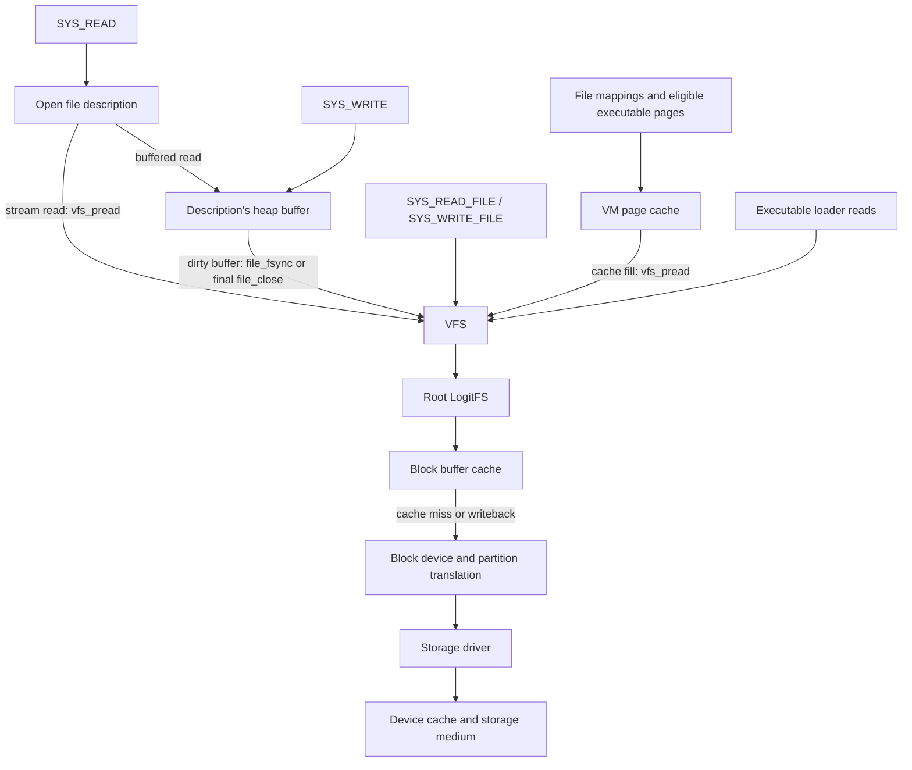

# Storage stack

LogitOS routes disk file access through the syscall layer, open file descriptions, the VFS, a filesystem backend and the block device registry. The root LogitFS mount holds its allocation bitmap and inode table in memory and uses a block buffer cache beneath a metadata journal. Read-only descriptors fetch file ranges through the VFS; writable descriptors accumulate changes in a heap buffer and submit a complete file replacement when flushed. The VM page cache supplies frames for file mappings and eligible executable pages.

## Layers and request paths

The diagram shows requests travelling toward storage. Read bytes and completion status return through the calling layers. The descriptor paths are implemented in `c/kernel/exec/syscall.c` and `c/kernel/exec/fd/file.c`.

The VFS resolves paths, checks permissions and selects the mount with the longest matching prefix at a path component boundary. It pins the mount while calling its backend. The backend interface provides whole file reads and writes alongside reads at a byte offset. These interfaces keep path and credential handling above filesystem allocation and journal operations. See `c/fs/vfs/vfs.h`, `c/fs/vfs/vfs.c` and `c/fs/vfs/vfs_path.c`.

## Selecting the root device

During boot, `c/kernel/init/kmain.c` initialises NVMe and VirtIO block support, calls `blk_init()`, registers LogitFS and attempts to mount it at the VFS root.

`blk_init()` in `c/drivers/block/blkdev.c` registers storage in this order:

1. NVMe.
2. VirtIO block.
3. AHCI SATA.
4. VirtIO SCSI.
5. Legacy ATA PIO.

Each disk precedes its own partition entries in the registry. AHCI and VirtIO SCSI register their discovered disks as a group before the block layer scans those disks for partitions.

Root selection walks the registry and chooses the first entry whose first sector contains recognised LogitFS magic, version and block size fields. If the search finds no matching signature, the first registered whole disk becomes the mount candidate. LogitFS mount validates the filesystem geometry and, for the identity format, its identity extension.

Partition parsing in `c/drivers/block/part.c` handles MBR, extended partition chains and GPT, including GPT header and entry array checksums. A partition’s `struct blkdev` holds its starting sector, length and parent disk. The block layer checks requests against that length and adds the starting sector before driver dispatch. This lets filesystem block numbers retain the same meaning on raw disks and partitions.

USB mass storage also registers disks and calls `blk_probe_partitions()` through the Bulk-Only Transport implementation in `c/drivers/usb/usb_storage.c`.

## Following a read

Consider an existing regular file on root LogitFS opened with `O_RDONLY`.

`SYS_OPEN` resolves the caller’s path and calls `file_open_vfs()`. After checking access, that function probes whether the path supports offset reads. A streamable description stores the path, file size and current offset. Subsequent reads fetch bytes through the saved path. This logic lives in `c/kernel/exec/fd/file.c`.

A descriptor read follows these steps:

1. `SYS_READ` acquires a reference to the description, validates the user destination and obtains a kernel staging buffer.
2. `file_read()` calls `vfs_pread()` at the description’s current offset.
3. The VFS resolves the path, checks read permission and dispatches the selected backend’s offset read.
4. LogitFS resolves the path to an inode and calls `inode_pread()`.
5. The inode’s block mappings lead through the block buffer cache. Cache misses submit reads to the selected root device.
6. The driver completes the transfer. Bytes return through LogitFS and the VFS, `file_read()` advances the offset, and the syscall copies the returned bytes into user memory.

`SYS_READ` caps one call at 64 KiB. Kernel callers can request larger ranges from the filesystem. `inode_pread()` copies partial blocks at the beginning and end through a staging buffer and groups the aligned middle into runs of consecutive disk blocks. The default run limit is `READ_RUN`, 128 blocks or 512 KiB. This coalesces device requests and bounds the block mapping array. See `c/kernel/exec/syscall.c` and `c/fs/logitfs/logitfs.c`.

LogitFS uses 4 KiB blocks. Its disk inode contains twelve direct block pointers, a single indirect pointer and a double indirect pointer. `imap()` and `imap_fill()` translate file block indices through those pointers. The disk layout is defined in `c/fs/logitfs/logitfs_fmt.h`.

The read interfaces serve different callers:

| Interface | Read shape |
|---|---|
| `vfs_pread()` | Reads a range at a byte offset and returns a short count at the end of the file. |
| `vfs_read()` on LogitFS | Reads the complete file into a buffer large enough to hold it. |
| `file_read()` on a buffered description | Copies bytes from that description’s heap buffer. |

Existing files opened for updates use the buffered path. `SYS_READ_FILE` calls the whole file VFS interface through a kernel staging buffer.

## Following a write

`SYS_WRITE` validates the user range and copies bytes through a kernel staging buffer in chunks of up to 64 KiB. For a writable filesystem description, `file_write()` copies those bytes into the description’s backing allocation, grows it as needed, advances the offset and marks it dirty. A write beyond the previous end fills the intervening bytes with zeros. The syscall returns the number of bytes accepted into that buffer.

This buffering follows the VFS write contract: the backend receives a complete replacement file. Opening an existing file for updates loads its contents into the description’s buffer so that later writes can preserve the surrounding bytes. The implementation is in `c/kernel/exec/fd/file.c`.

Two paths submit a dirty description to `vfs_write()`:

- `SYS_FSYNC` calls `file_fsync()`.
- `file_close()` writes the contents when it releases the final reference.

`file_fsync()` submits the complete buffered contents and clears the dirty flag after success. `SYS_WRITE_FILE` reaches `vfs_write()` directly through a kernel staging buffer.

For a regular filesystem path, the VFS checks write permission on an existing file or creation permission in its parent directory. It calls the backend write and invalidates matching VM page cache entries after success. Subsequent cache fills can then fetch the updated backend contents. See `c/fs/vfs/vfs.c`.

Within LogitFS, `logitfs_write_locked()` saves undo state, starts a transaction and calls `inode_write()`. Replacement allocates new data blocks. Releases of the previous blocks remain pending while replacement data is prepared, then enter the bitmap staged for commit.

File data enters the block buffer cache at its final block addresses. Inode table blocks, allocation bitmaps, indirect blocks and directory contents enter the transaction’s metadata buffers. Preparation failures restore the saved inode and bitmap state. The filesystem lock serialises operations over this shared state. These mechanisms live in `c/fs/logitfs/logitfs.c`.

Flushing the block cache submits device writes and waits for their completion. The filesystem commit result returns through the VFS to `file_fsync()` or final `file_close()`, then to the syscall caller.

## Journal ordering and recovery

LogitFS journals metadata and orders file data before the metadata commit. `log_commit()` uses three stages, each followed by `bcache_sync()`. That operation writes dirty buffers and calls `blk_flush()`.

| Stage | Writes covered by the following flush |
|---|---|
| B1 | New file data and the journal’s metadata body blocks. |
| B2 | The commit header, containing the body checksum and destination block numbers. |
| B3 | Metadata installed at its final block addresses. |

With successful writes and flushes, B1 establishes the data and journal bodies before the commit record. B2 establishes the record before metadata installation. B3 establishes the installed metadata before the header is cleared.

The final header clear passes through the cache and can reach the device through eviction or a later sync. Replaying a record whose metadata was already installed repeats the same block copies to the same destinations.

The header contains CRC-32 checksums for the header and its body blocks. Recovery checks these to detect torn headers and stale headers paired with different transaction bodies. During transaction construction, filesystem reads consult staged metadata first, allowing an operation to read its own changes. See `c/fs/logitfs/logitfs.c` and `c/fs/logitfs/logitfs_fmt.h`.

At mount, LogitFS invokes `fsck_log_recover()` before loading the bitmap and inode table. Recovery validates the record and its destinations, replays accepted metadata, syncs the installation and clears the record. Mount then loads metadata and runs a consistency check that reports its findings. Recovery and checking share `c/fs/logitfs/fsck.c`.

`tests/unit/fs_crash_test.c` runs the filesystem against a simulated device and interrupts file creation, overwrite, directory creation, deletion and rename at device writes. Its assertions check remounting, metadata consistency and file contents after simulated power loss.

## Caching layers

The stack retains several forms of storage data:

| Layer | Contents and identity | Purpose |
|---|---|---|
| Open file description | Buffered file contents belonging to one description | Supports offset updates before a complete file replacement. |
| Mounted LogitFS metadata | Allocation bitmap and inode table | Supplies allocation and inode operations from memory. |
| Transaction buffers | Metadata blocks and their destination block numbers | Collects metadata for journal commit. |
| Block buffer cache | Blocks numbered within the selected root filesystem | Reuses data and metadata blocks and holds dirty blocks for writeback. |
| VM page cache | Physical frames keyed by device, inode and file page index | Shares file pages among mappings and supports reclaim. |
| Device write cache, when present | Writes accepted by the device | Receives flush commands at filesystem ordering points. |

The block cache uses a hash index and a least recently used list. Its default pool contains 256 buffers of 4 KiB each, giving 1 MiB of data storage. LogitFS mount retries with smaller pools if allocation fails. Defaults and interfaces are in `c/fs/cache/bcache.h`; implementation and mount policy are in `c/fs/cache/bcache.c` and `c/fs/logitfs/logitfs.c`.

`bcache_read_run()` serves resident blocks from their buffers and groups consecutive misses into device reads. It installs newly read blocks when the requested run occupies at most one quarter of the pool. Larger runs go into the caller’s buffer, reducing cache churn during streaming reads. Resident blocks still supply their current contents within those runs.

`bcache_write()` updates a buffer and marks it dirty. Eviction and `bcache_sync()` write dirty buffers to the device. The journal establishes ordering through completed sync stages, since eviction can write dirty blocks between those stages.

`bcache_sync()` collects dirty buffers into batches of up to sixteen `struct blk_span` entries and submits them through `blk_write_batch()`. Each span carries a completion status. Successful writes clear their buffers’ dirty flags; failed writes retain dirty buffers for retry. All batches finish before the final `blk_flush()`. The batch bound limits request storage on the kernel stack.

The VM page cache holds physical frames that processes can map. Its VFS adapter obtains file identity through `vfs_statx()` and fills pages through `vfs_pread()`. Executable loading can reserve eligible pages as file mappings, while loader reads also access the VFS directly. Reclaim can discard cached file pages and reconstruct them from storage. See `c/kernel/mm/cache/pcache.c`, `c/kernel/mm/cache/pcache_vfs.c`, `c/kernel/exec/load/elf.c` and `c/kernel/mm/reclaim/reclaim.c`.

## Device transfer and completion

The block interface measures requests in 512-byte sectors. Each LogitFS block spans eight sectors. The root wrappers `blk_read()`, `blk_read_n()` and `blk_write()` forward requests to the selected `struct blkdev`.

A `struct blk_req` records the operation, buffer, sector range and completion status. `blk_submit()` admits work, `blk_poll()` advances completion and `blk_wait()` waits synchronously through that interface. The parent disk owns the request gate and list of requests in flight, so its partitions share admission and ordering. AHCI and NVMe use submit and poll callbacks; VirtIO block and ATA PIO use synchronous callbacks. See `c/drivers/block/blkdev.h` and `c/drivers/block/blkdev.c`.

The earlier interlock admitted one request per medium. The current interface supports a queue depth selected by the driver, with one as the default and 32 as the block layer’s maximum. Admission drains overlapping requests whenever either request writes, using absolute sector ranges across partitions. A flush drains earlier requests and holds subsequent requests until completion.

Submission rechecks request state under the medium gate. This preserves completion published by another CPU while the submitter waited for admission and prevents an older write from being replayed after a newer overlapping write.

`blk_dev_batch()` submits requests in groups of up to sixteen, then waits for every result before reusing their storage. `blk_write_batch()` applies this interface to the root device. Batching supplies concurrent work during cache sync; the driver’s admission depth controls how much can remain in flight.

AHCI brings up candidate SATA ports whose link or signature needs initialisation. It programs command and receive memory, enables FIS reception and issues COMRESET when required before identifying the disk. IDENTIFY supplies capacity, logical sector size and queue capabilities. See `c/drivers/block/ahci.c`.

AHCI enables Native Command Queuing (NCQ) when the controller and disk support it, the disk uses LBA48 addressing and the resulting data depth is at least two. The data depth is bounded by the drive’s depth and the controller’s slot count minus one. Reserving a slot provides space for internal commands during recovery. Each data slot owns its command and DMA mapping. Transfer chunks are bounded at 1 MiB by `DMA_MAX_MAPPING` in `c/drivers/core/dma.h`.

Root mount uses AHCI polling. After SMP initialisation and `dev_probe_all()`, `c/kernel/init/kmain.c` calls `ahci_irq_attach()`. Attachment requests MSI and checks delivery with an IDENTIFY command, retaining polling when MSI allocation or delivery fails. The interrupt handler records status and acknowledges port sources before the controller source. The medium gate’s poll path performs request completion and DMA cleanup.

At attachment, AHCI also compares up to sixteen queued 4 KiB reads with serial reads using nonqueued commands. A failed queued comparison reduces admission depth to one. A failed nonqueued baseline takes the disk offline. Queue recovery stops the port, consumes completed DMA transfers and quiesces the remaining mappings before retrying work. These paths are implemented in `c/drivers/block/ahci.c`.

For VirtIO block, the driver constructs a descriptor chain containing a request header, payload and status byte. It maps the payload through the DMA interface and calls `virtio_request()`. The transport publishes the chain and polls for a matching used-ring entry. The block driver checks status and the returned read length, completes the DMA mapping and releases it before returning. See `c/drivers/virtio/virtio_blk.c` and `c/drivers/virtio/virtio.c`.

`blk_flush()` dispatches a flush through the selected device. VirtIO block sends a flush request when its flush feature was negotiated. These operations provide the device ordering points used by cache sync and journal commit.

The `test-ahci` target in `Makefile` invokes `tests/boot/run-ahci-test.sh` for raw, MBR, GPT and two-controller QEMU configurations. The harness checks discovery, root selection, mounting and file contents read through the guest shell.

## Limitations

- Writable descriptions require a contiguous heap buffer. File replacement requires free blocks for new contents while previous blocks remain allocated. Heap space, free blocks and journal capacity constrain updates.
- Open descriptions retain paths. Stream reads and buffered flushes resolve those paths again, so deletion, rename or replacement can affect access through an existing description.
- `SYS_READ_FILE` caps its staging buffer at 64 KiB, while LogitFS requires space for the complete file through that interface. Larger files require descriptor reads or other offset reads.
- Writable file mappings are refused in `c/kernel/mm/mmsys.c`. Page cache invalidation removes cache entries, while existing process mappings can retain their previous frames, as documented in `c/kernel/mm/cache/pcache.c`.
- `log_commit()` records I/O errors and continues its remaining stages. An error can accompany changes already applied in memory or on disk. Failed `file_fsync()` retains the dirty flag for retry. Final `file_close()` frees its buffer even when flushing fails; `SYS_CLOSE` returns `-2` when its reference release triggers that failure. See `c/kernel/exec/proc.c`.
- A failed block cache victim writeback can cause `bcache_write()` to attempt a direct device write for the requested block. This fallback is implemented in `c/fs/cache/bcache.c`.
- VirtIO block sends a flush command only when its flush feature was negotiated; otherwise it returns success. The driver treats such a device as lacking a writeback cache. Durability depends on the device satisfying the driver’s ordering assumptions.
- AHCI accepts SATA disks with 512-byte logical sectors and skips ATAPI devices and port multipliers. Comments in `c/drivers/block/ahci.c` and `c/fs/cache/bcache.c` identify model and QEMU evidence for MSI, NCQ, recovery and batched writeback; verification of those changes on X79-VG4 hardware remains outstanding.
- `TRANSPARENCY.md` retains the statement that LogitFS “does not make a documented journaling or crash-consistency guarantee.” The journal mechanism and simulated crash scenarios described here establish the scope of this page’s claims.

## Source map

| File | What it contains |
|---|---|
| `c/kernel/init/kmain.c` | Storage initialisation, root mount, page cache adapter installation and late AHCI interrupt attachment. |
| `c/kernel/exec/syscall.c` | File syscalls, staging buffers, transfer limits and user copying. |
| `c/kernel/exec/fd/file.c` | Stream reads, buffered updates, sync and final close. |
| `c/kernel/exec/proc.c` | Descriptor references and close error reporting. |
| `c/fs/vfs/vfs.h` | Filesystem backend interfaces. |
| `c/fs/vfs/vfs.c` | Mount dispatch, permission checks and page cache invalidation. |
| `c/fs/vfs/vfs_path.c` | Path walking and mount prefix matching. |
| `c/fs/logitfs/logitfs_fmt.h` | Block, inode, superblock and journal layouts. |
| `c/fs/logitfs/logitfs.c` | Allocation, file I/O, transactions, commit and mount. |
| `c/fs/logitfs/fsck.c` | Journal validation, replay and consistency checking. |
| `c/fs/cache/bcache.h` | Block cache interface and default pool dimensions. |
| `c/fs/cache/bcache.c` | Lookup, eviction, run reads and batched writeback. |
| `c/drivers/block/blkdev.h` | Device, request and batch interfaces. |
| `c/drivers/block/blkdev.c` | Discovery, root selection, partition translation, admission and completion. |
| `c/drivers/block/part.c` | MBR, extended partition and GPT parsing. |
| `c/drivers/block/ahci.c` | SATA initialisation, NCQ, MSI, DMA completion and recovery. |
| `c/drivers/core/dma.h` | DMA interfaces and maximum mapping size. |
| `c/drivers/virtio/virtio_blk.c` | Block requests, DMA payload handling and flushes. |
| `c/drivers/virtio/virtio.c` | Virtqueue submission and completion polling. |
| `c/drivers/usb/usb_storage.c` | USB mass storage discovery and block registration. |
| `c/kernel/mm/cache/pcache.c` | File page storage, invalidation and frame ownership. |
| `c/kernel/mm/cache/pcache_vfs.c` | VFS identity and read callbacks for the page cache. |
| `c/kernel/mm/mmsys.c` | File mapping syscall and protection checks. |
| `c/kernel/exec/load/elf.c` | Loader reads and executable file mappings. |
| `c/kernel/mm/reclaim/reclaim.c` | Reclaim of cached file pages. |
| `tests/unit/fs_crash_test.c` | Simulated power loss and filesystem assertions. |
| `tests/boot/run-ahci-test.sh` | AHCI discovery, root selection and file reads in QEMU. |
| `Makefile` | AHCI test target configurations. |
| `TRANSPARENCY.md` | Project claim rules and recorded limitations. |

## See also

- [Virtual file system](../filesystems/vfs.md)
- [LogitFS](../filesystems/logitfs.md)
- [Block cache](../filesystems/block-cache.md)
- [Storage drivers](../drivers/storage.md)
- [VirtIO drivers](../drivers/virtio.md)
- [Page cache, reclaim and swap](../kernel/page-cache-and-reclaim.md)
