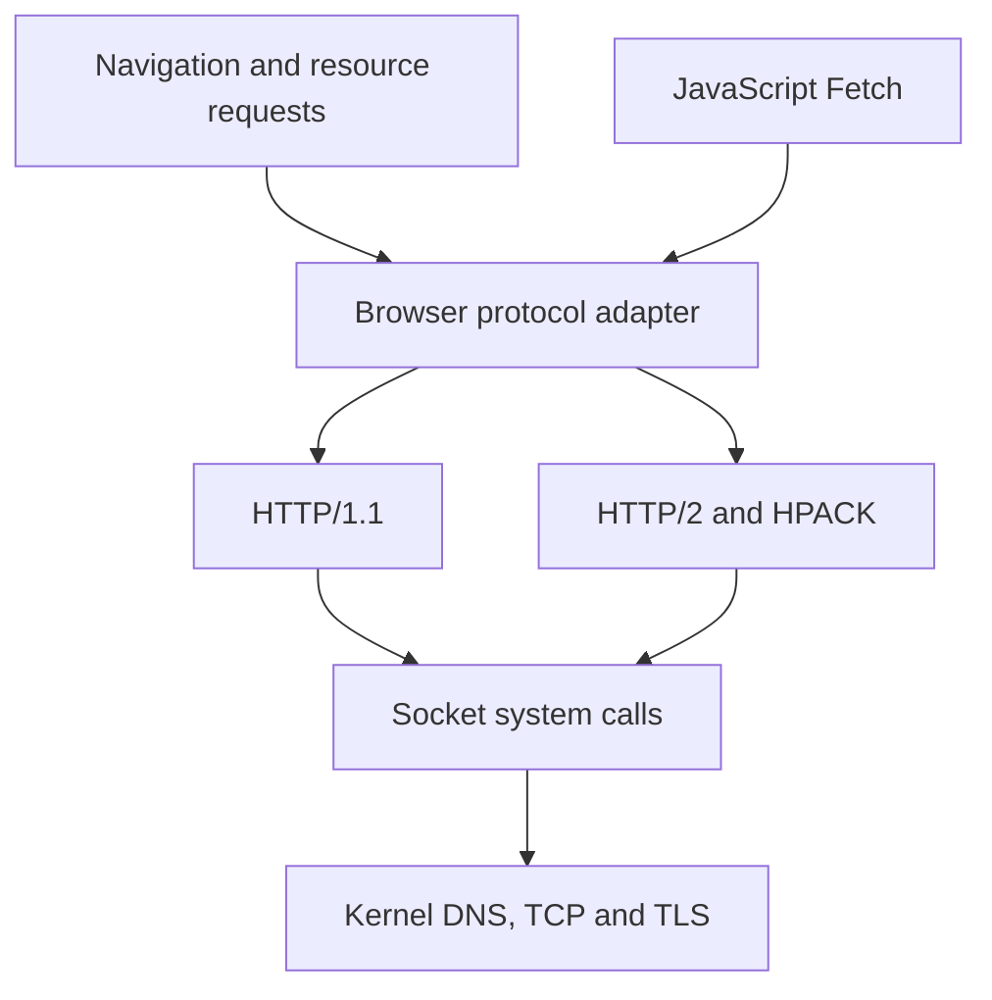

# Loading pages: fetch, URLs and the HTTP cache

The browser loads documents, subresources and JavaScript Fetch responses in ring 3. It links HTTP parsing and connection management into the application, then uses socket system calls to reach the kernel’s DNS, TCP and TLS implementations. Request state, connection state and cached representations have different lifetimes. Their main integration points are `c/apps/gui/browser/app/runtime.c` and `c/apps/gui/browser/js/runtime/webapi.c`.

## Fetch contracts

The browser has two request interfaces.

| Interface | Contract |
|---|---|
| Resource fetcher | Navigation and resource loaders start GET requests through `bfetch_start_nav_from()`, `bfetch_start()` or `bfetch_start_from()`. Handles expose state, status, final URL, body and error. |
| JavaScript Fetch | `fetch()` returns a Promise. Native state advances through `js_webapi_pump()`. The Promise resolves after response headers pass policy checks, and body bytes arrive through a `ReadableStream`. |

The resource interface in `c/apps/gui/browser/net/fetch.h` reports `BF_PENDING`, `BF_DONE` or `BF_FAILED`. HTTP status remains available through `bfetch_status()`. The synchronous helper `bfetch_sync()` requires both completion and a 2xx status.

`bfetch_body()` borrows the request’s buffer until release. An empty response can have a null body pointer and length zero. `bfetch_take()` transfers ownership and releases the handle, allocating a buffer of one byte holding a NUL terminator for an empty response when allocation succeeds. The caller frees the transferred buffer. Buffered payloads carry a terminating NUL after their recorded length.

`bfetch_pump()` advances outstanding requests. `bfetch_wait()` pumps, calls an optional UI callback and yields between passes. The rendering bridge `res_fetch()` handles data URLs, takes prefetched bytes when available and otherwise calls `bfetch_sync()`. These paths are implemented in `c/apps/gui/browser/app/runtime.c`.

JavaScript request construction lives in `c/apps/gui/browser/js/net/fetch_body_prelude.inc`. It converts strings, ArrayBuffers, typed-array and DataView slices, Blobs, FormData and URLSearchParams into bytes before native dispatch. A view contributes its byte offset and byte length, preserving the selected portion of its backing buffer.

The JavaScript admission queue is FIFO. Its six admission permits are released when Fetch Promises settle, while the native table’s eight slots stay occupied until the body completes. Admission checks both counts so resolved responses with active bodies continue to consume capacity. The resource table provides sixteen slots accessible to subresources and a seventeenth slot accessible to navigation.

## URL resolution and document identity

The HTTP transport uses `struct url` in `c/net/http/url.h`, containing scheme selection, hostname, port and request target. `url_parse()` selects the default HTTP or HTTPS port, supplies `/` for a missing path and strips fragments from the wire path. `url_resolve()` handles absolute, protocol-relative, root-relative and directory-relative references.

The resource resolver in `c/apps/gui/browser/net/url.inc` wraps this transport parser. Resolution against an HTTP base also removes path segments containing `.` and `..`, while retaining query and fragment data. This gives resource references such as module imports and stylesheet URLs normalized paths.

The resource resolution base and initiating document have different owners. `bfetch_set_base()` supplies the resolution base; `bfetch_set_document()` records the committed document identity used for cookie context. Requests capture their initiator at construction, so a later change to a stylesheet or import base applies to future requests only.

JavaScript HTTP requests use `wurl_parse()` in `c/apps/gui/browser/js/runtime/webapi.c`. It stores pathname, query and fragment in distinct fields and removes path dot segments. A reference that carries only a query retains the base pathname; one that carries only a fragment retains its other components. The request target combines pathname and query.

The script-visible `URL` and `URLSearchParams` implementations use the parser in `c/apps/gui/browser/js/net/url.c`. DOM integration in `c/apps/gui/browser/js/net/urlbind.c` computes `document.baseURI` from the first `<base href>` in tree order, resolving it against the document’s fallback URL. Hyperlink accessors use this document base.

## From the browser to TCP and TLS

Both loaders use `struct h1_conn` and `struct h1_response`. The protocol adapter in `c/apps/gui/browser/app/runtime.c` presents HTTP/1.1 and HTTP/2 exchanges through that shared interface.

`c/net/http/http1.c` serializes requests and parses responses incrementally through transport callbacks. HTTP/2 framing and streams live in `c/net/http/http2.c`, with header compression in `c/net/http/hpack.c`. The browser links these files through `BROWSER_PIPE` in `Makefile`.

For HTTPS, the adapter offers HTTP/2 and HTTP/1.1 through ALPN and reads the negotiated result with `sock_alpn()`. Concurrent requests can join an existing HTTP/2 session or a pending handshake. When a pending connection selects HTTP/1.1, the adapter provides sockets for exchanges that need their own connection. Plain HTTP selects HTTP/1.1.

The resource pool is configured for six connections overall, two per origin and an idle expiry of sixty seconds. The comment beside `hpool_config()` records the reason: certificate verification under emulation made additional TLS handshakes expensive. Resource GETs request HTTP/1.1 keep-alive. JavaScript Fetch emits `Connection: close` on HTTP/1.1; the HTTP/2 adapter converts Host into the authority pseudo-header and removes fields specific to the connection.

Socket wrappers in `c/apps/logit.h` enter `c/kernel/exec/syscall.c`. The handlers validate user buffers and pass the current process ID to `c/net/core/sock.c`. `net_poll()` in `c/net/core/net.c` advances DNS and socket state.

For HTTPS sockets, connected readiness follows successful TLS negotiation. The TLS certificate verifier receives the hostname and time, and diagnostics distinguish failures of hostname, validity, trust path and signature. Handshake startup also checks the kernel RNG’s strength. These checks are in `c/net/tls/tls.c`.

## Headers and body delivery order

HTTP header storage preserves a list of fields. Lookup is case-insensitive: `h1_headers_get()` returns the first match, while count and indexed lookup expose repeated fields. `h1_request_build()` validates the method, target and fields, then serializes stored headers in list order. An automatically generated Content-Length follows that list.

JavaScript `Headers` iteration sorts names and combines repeated values in their original order with `, `. The general header-list implementation yields each Set-Cookie occurrence individually. Network response filtering removes Set-Cookie and Set-Cookie2 before constructing page-visible headers. The implementation spans `c/apps/gui/browser/js/net/fetch_body_prelude.inc` and `c/apps/gui/browser/js/runtime/webapi.c`.

Fetch processes cookies, checks CORS and decides response visibility at the header boundary. Cross-origin CORS responses expose the response safelist and permitted names from Access-Control-Expose-Headers. A cross-origin `no-cors` response receives an opaque filter. Requests requiring a CORS preflight send OPTIONS before the application request.

HTTP/1.1 can parse headers and initial body bytes in one read. Fetch holds those bytes until its header decision completes. The HTTP/2 adapter returns after first publishing headers to a caller with a body sink, then drains queued DATA on a later pump. This ordering lets Fetch make its policy decision before receiving a body batch larger than its 4096-byte holding buffer.

`tests/unit/fetch_header_order_test.c` exercises this boundary with coalesced HTTP/2 headers and DATA, cancellation after headers and compressed-body buffering.

## Body framing and size policies

The HTTP/1.1 parser handles Content-Length, chunked framing and bodies ending at connection close. It checks repeated Content-Length values for agreement and grows buffered storage as bytes arrive. A buffered Content-Length exceeding the configured ceiling fails before body allocation.

The browser advertises gzip and deflate. `h1_decode_body()` uses the inflater in `rust/src/inflate.rs`, applying the response ceiling to decoded output as well as buffered encoded input.

| Path | Configured policy |
|---|---|
| Generic HTTP/1.1 buffered response | `H1_BODY_MAX`: 8 MiB |
| Browser subresource or buffered JavaScript response | `BROWSER_BUFFERED_BODY_MAX`: 16 MiB |
| Embedded document transport | `BROWSER_EMBEDDED_BODY_MAX`: 4 MiB |
| Top-level navigation transport | 64 MiB |
| Navigation accepted for document rendering | 16 MiB |
| HTTP/2 stream staging | `BX_H2_BODY_MAX`: 32 MiB |
| JavaScript body queue | Pumping pauses when recorded queued bytes exceed `WF_HIGHWATER`, 512 KiB |
| HTTP/1.1 header parser | 8192-byte line buffer, 65536-byte header-section ceiling and 256 fields |

The browser ceiling in `c/apps/gui/browser/net/fetch.h` records its motivating measurement: a 2,724,940-byte gzip script expanded to 10,589,862 bytes, exceeding the generic parser’s default.

Identity responses with a body sink deliver bytes incrementally. Fetch applies backpressure by pausing pumps when its queue grows beyond the threshold. Compressed responses accumulate until completion, then decode and enter the JavaScript stream. The HTTP/2 adapter drains stream staging into either the sink or a response buffer and enforces the response ceiling on buffered accumulation.

These policies live in `c/net/http/http1.c`, `c/apps/gui/browser/app/runtime.c`, `c/apps/gui/browser/js/runtime/webapi.c` and `c/apps/gui/browser/app/downloads.inc`.

## Resource caches

The resource loader maintains two caches in process memory.

| Cache | Purpose |
|---|---|
| Prefetch cache | Retains up to 32 entries for later consumption by `res_fetch()`. Taking an entry transfers its body. Navigation clears it. |
| HTTP cache | Retains representations across navigation, with freshness, validators, 64 entries and an 8 MiB body-byte budget. Eviction selects the least recently used entry. |

Prefetching queues transfers before callers decode each resource. The comment in `c/apps/gui/browser/net/fetch.h` describes image decoding taking long enough for idle pooled connections to expire. Queuing the batch overlaps transfers with that work. `c/apps/gui/browser/app/runtime.c` also retains deferred prefetch URLs while request handles are occupied.

The HTTP cache is implemented in `c/apps/gui/browser/net/cache.c`, included by the runtime. The loader stores complete, nonempty 2xx GET responses whose request carried no range. Stored Content-Type and Content-Disposition preserve attachment classification on a cache hit.

The key contains the absolute URL string and a 64-bit hash of the outgoing Cookie header. `build_get()` captures the cookie bytes when serializing the request. Cache storage and revalidation use that captured value because response Set-Cookie processing can change the jar before completion.

The store accepts an empty Vary value and the single values `Accept-Encoding` or `Cookie`. Storage refuses other variant dimensions. Embedded document requests bypass HTTP cache lookup and storage; their transport contract requires response policy metadata for embedding decisions.

## Freshness and revalidation

Freshness compares monotonic elapsed time since storage against a computed lifetime. Lifetimes come from differences between the Date and Expires values in server responses.

`compute_lifetime()` in `c/apps/gui/browser/net/cache.c` uses this precedence:

| Metadata | Initial storage policy |
|---|---|
| `Cache-Control: no-store` | Refuse storage |
| `Cache-Control: no-cache` | Store with zero freshness lifetime |
| Parsed `max-age=N` | Use N seconds |
| Parsed Expires and Date, with Expires ≥ Date | Use Expires minus Date |
| Parsed Last-Modified and Date, with Date > Last-Modified | Use 10% of Date minus Last-Modified |
| Remaining cases | Use sixty seconds |

Initial lifetimes are capped at 300 seconds. A response containing Set-Cookie receives an additional cap of sixty seconds.

A fresh lookup returns a copied body and completes the resource request with status 200 before opening a connection. A stale entry supplies ETag and Last-Modified for conditional headers. When a conditional request receives 304 and the cached body remains available, the loader returns those bytes with status 200 and refreshes freshness from the 304’s Cache-Control, Expires and Date. An unusable 304 produces a named failure.

Successful unsafe requests invalidate cached variants of their target URI when response headers arrive with a 2xx or 3xx status. Target matching accounts for hostname case, equivalent default ports and fragments, while preserving query significance. This integration is in `c/apps/gui/browser/app/runtime.c`.

The older comments in `c/apps/gui/browser/net/fetch.h` and the runtime describe keyboard reload bypass as pending. The current reload branch in `c/apps/gui/browser/app/main.c` calls `bfetch_set_bypass(1)` around `load()` and resets it afterward. HTTP cache lookup and storage observe that flag during the load.

## Redirects and ranges

Both loaders recognize 301, 302, 303, 307 and 308 through `h1_is_redirect()` in `c/net/http/http1.c`.

The resource loader follows up to eight redirects. It processes response cookies, resolves Location against the current URL, preserves navigation classification and clears validators belonging to the previous URL. Each hop enters the network path; completed bytes can be stored under the final URL.

JavaScript Fetch follows up to ten redirects. It checks CORS and the document connect policy, updates origin and cookie context, and removes author Authorization on an origin change. The implemented method policy is:

| Status | Method and body |
|---|---|
| 307 or 308 | Preserve both |
| 301, 302 or 303 with HEAD | Preserve HEAD |
| 301, 302 or 303 with another method | Select GET and drop the body |

This policy comes from `h1_redirect_method()` and its caller in `c/apps/gui/browser/js/runtime/webapi.c`.

The resource range API takes a first byte and an inclusive last byte. A negative last value requests the remainder. Range requests send `Accept-Encoding: identity`; a 206 answer is checked against Content-Range, requested offsets and received length before being accepted.

A successful response that returns the whole resource to a range request reports `BF_R_IGNORED`. The asynchronous caller can inspect that result and the HTTP status; `bfetch_sync_range()` requires `BF_R_PARTIAL`. A 416 response reports `BF_R_UNSATISFIABLE` and fails the request. The checks keep partial bytes out of caches that hold whole resources.

## Errors and diagnostics

HTTP error statuses can resolve JavaScript Fetch with a Response. Transport, parsing and policy failures reject the Promise before response delivery or error its body stream afterward. Abort handling preserves the supplied JavaScript reason, including null and false. Cancelling a response stream releases the native transfer.

JavaScript requests use an idle deadline of thirty seconds renewed by header or body progress. The pump compensates for observation gaps exceeding 250 milliseconds and renews the deadline while backpressure pauses reading. An unanswered GET or HEAD can retry once across the Fetch operation after a transport or truncation error, while response headers remain unavailable.

Resource requests have an attempt budget of sixty seconds and a budget of ninety seconds covering queueing, redirects and retries. Comments call the attempt budget an idle deadline; the implementation measures elapsed time from construction, retry or redirect. A deadline of twelve seconds for the first response starts when the exchange begins. HTTP/1.1 counts received transport bytes; the HTTP/2 adapter records progress when final headers become available.

| Diagnostic surface | Information |
|---|---|
| `bfetch_error()` and `[bfetch]` | Resource failure reasons, retries and range decisions |
| `sock_why()` in `include/abi/sockerr.h` | DNS, connection, TLS and socket-capacity errors |
| `[webapi] fetch-request`, `fetch-response`, `fetch-detail`, `fetch-complete` | Request metadata, status, failure boundary, byte counts and completion |
| `[bxfer]` | ALPN selection and buffered-body ceiling failures |
| `[tls]` | TLS alerts and certificate verification reasons |
| `[wa]` | Guest monotonic navigation, document completion, network-idle and load-end timestamps |

The four Fetch trace messages use transport metadata and fixed payload categories, with hostname text checked before logging. Resource diagnostics also print URLs.

## WebSocket bindings

`c/apps/gui/browser/js/net/websocket.c` gives each WebSocket a dedicated socket. Secure connections offer HTTP/1.1 through ALPN, preserving ownership of the upgraded byte stream.

The opening GET and 101 response use the HTTP/1.1 connection parser. The binding validates Upgrade, Connection and Sec-WebSocket-Accept, then feeds bytes read beyond the headers into the frame codec in `c/net/http/ws.c`.

`js_websocket_pump()` advances connections from the page loop in `c/apps/gui/browser/js/runtime/page.c`. The wrapper in `c/apps/gui/browser/js/net/websocket_prelude.inc` supplies EventTarget events, text and binary messages, subprotocol offers and buffered output accounting.

Configuration provides eight connections, a ceiling of 16 MiB on assembled messages and a 1 MiB buffer for outgoing framed bytes. Dialing has a deadline of thirty seconds; entering the HTTP handshake starts another deadline of thirty seconds renewed by received bytes. Closing waits up to five seconds for the peer.

## Download bindings

`c/apps/gui/browser/js/net/download.c` handles anchors and areas carrying a download attribute. Same-origin HTTP and HTTPS links enter the application queue. Blob and data links obtain bytes through Fetch, with an origin check for blob links. Blob capture happens before Promise callbacks, supporting revocation immediately after activation.

`c/apps/gui/browser/app/downloads.inc` stages navigation responses while the committed document remains active. Classification uses Content-Disposition, Content-Type, the download request and filename extensions. Successful complete attachments enter the save path; document responses pass to the page loader. The queue holds four jobs, and download storage accepts bodies up to 64 MiB. A redirect that changes origin clears the page’s flag that forces download, along with its suggested filename.

Saving lives in `c/apps/gui/browser/app/tabs.c`. Shared naming rules in `c/apps/download_name.h` prefer UTF-8 `filename*`, then filename, a caller suggestion and the URL basename. Sanitization produces a basename under `/download`.

The save path chooses an available name, uses a staging directory when rename is available and compares the saved bytes through readback before marking success. Results appear in download records, the status bar and `[download]` messages.

## Limitations

- JavaScript Fetch bypasses the resource HTTP cache. `Request.cache` and `Request.redirect` are stored attributes with no transport effect. Dispatch forwards `init.mode` and `init.credentials`; it also omits those options from an input Request. ReadableStream request bodies are rejected.
- Transport URL parsing has smaller bounds and grammar than the script-visible URL parser. Host and path arrays are 128 and 512 bytes; JavaScript request parsing clips oversized query and fragment fields.
- The HTTP cache lasts for the browser process. Policy reads use the first matching header value, freshness omits Age adjustment, and date parsing supports IMF-fixdate. A 304 refresh recomputes lifetime from its supplied freshness fields without merging the previous freshness metadata. Cookie keys use a noncryptographic hash.
- Redirect hop limits can leave a 3xx response for the caller. The method rewriting shown above also applies to methods such as PUT on 301 and 302.
- The resource range interface supports one range beginning at a supplied offset. Suffix ranges and multipart range responses are unsupported.
- WebSocket handshake redirects, negotiated extensions and WebSocket over HTTP/2 are unsupported.
- `TRANSPARENCY.md` classifies the browser, networking and TLS implementations as experimental educational code and records the limits of their security and standards conformance.

## Regression coverage

`tests/unit/wa_cache_test.c` exercises freshness, validators, cookie variants, metadata and eviction. `tests/unit/fetch_header_order_test.c` exercises the protocol adapter with a simulated Fetch consumer; its fixture measures transport ordering without linking QuickJS.

`tests/webapi_headers.mk` defines checks for sorted and combined JavaScript header iteration. `tests/fetch_body.mk` defines checks for request-body bytes and view offsets. Their control builds restore the corresponding faulty behavior, and `tests/fetch_header_order.mk` makes its ordering control a prerequisite of the positive check.

## See also

- [The browser application: windows, tabs and navigation](app-and-navigation.md)
- [DOM and event bindings](dom-bindings.md)
- [Browser security model](security-model.md)
- [Testing the browser](testing.md)
- [Sockets](../networking/sockets.md)
- [HTTP](../networking/http.md)
- [TLS and certificates](../networking/tls.md)

## Source map

| File | What it contains |
|---|---|
| `c/apps/gui/browser/net/fetch.h` | Resource API, ownership, ranges and browser body ceilings |
| `c/apps/gui/browser/app/runtime.c` | Resource requests, prefetching, cache integration and protocol adapter |
| `c/apps/gui/browser/net/url.inc` | Resource URL resolution and path normalization |
| `c/apps/gui/browser/net/cache.h`, `c/apps/gui/browser/net/cache.c` | HTTP cache contract, keys, freshness, validators, metadata and eviction |
| `c/apps/gui/browser/js/runtime/webapi.c` | Native Fetch, request URLs, CORS, cookies, redirects, cancellation and diagnostics |
| `c/apps/gui/browser/js/net/fetch_body_prelude.inc` | Headers, Request, Response, body conversion and admission queue |
| `c/apps/gui/browser/js/net/fetch_hooks_prelude.inc` | Response stream callbacks and cancellation |
| `c/apps/gui/browser/js/net/url.c`, `c/apps/gui/browser/js/net/urlbind.c` | Script-visible URLs and document base integration |
| `c/apps/gui/browser/js/net/websocket.c`, `c/apps/gui/browser/js/net/websocket_prelude.inc` | WebSocket transport and JavaScript interface |
| `c/apps/gui/browser/js/net/download.c` | Download attribute bindings and byte submission |
| `c/apps/gui/browser/js/runtime/page.c` | Fetch and WebSocket pumps |
| `c/apps/gui/browser/app/main.c` | Navigation integration and keyboard reload bypass |
| `c/apps/gui/browser/app/downloads.inc` | Download queue and navigation staging |
| `c/apps/gui/browser/app/tabs.c`, `c/apps/download_name.h` | Download classification, naming and verified saving |
| `c/apps/logit.h`, `c/kernel/exec/syscall.c` | Socket wrappers, buffer validation and syscall dispatch |
| `include/abi/sockerr.h` | Socket error descriptions |
| `c/net/core/sock.c`, `c/net/core/net.c` | Kernel socket lifecycle and network progress |
| `c/net/http/url.h`, `c/net/http/url.c` | HTTP transport URL representation and resolution |
| `c/net/http/http1.h`, `c/net/http/http1.c` | HTTP/1.1 fields, serialization, framing, decoding and redirects |
| `c/net/http/http2.c`, `c/net/http/hpack.c`, `c/net/http/hpool.c` | HTTP/2 streams, header compression and connection pooling |
| `c/net/http/ws.c` | WebSocket handshake helpers and frame codec |
| `c/net/tls/tls.c` | TLS handshake startup, certificate checks and diagnostics |
| `rust/src/inflate.rs` | Inflation used by HTTP content decoding |
| `Makefile` | Browser HTTP source linkage |
| `tests/unit/wa_cache_test.c` | HTTP cache policy fixtures |
| `tests/unit/fetch_header_order_test.c`, `tests/fetch_header_order.mk` | Header-delivery ordering fixture and control |
| `tests/webapi_headers.mk`, `tests/fetch_body.mk` | Header iteration and request-body checks |
| `TRANSPARENCY.md` | Project claim and evidence rules |
