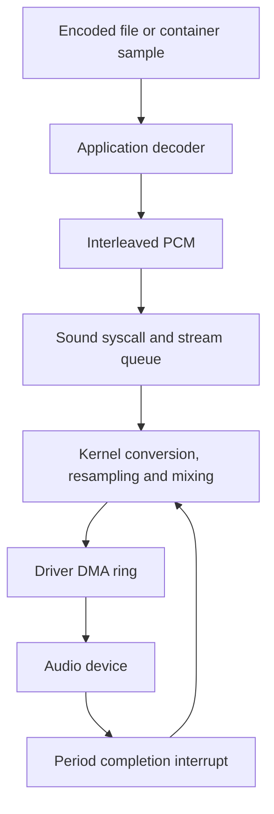

# Audio codecs and processing

The audio library in `c/lib/audio/` decodes WAV, FLAC, MP3, AAC, and Vorbis files, and provides an Opus packet decoder. Applications use its common interface to pull interleaved PCM or call codec interfaces for container playback. Shared FFT, inverse transform, bit reading, and math helpers support the decoders. PCM reaches the output device through the kernel sound streams, conversion, resampling, and mixing layers.

## Library placement

The `Makefile` excludes `c/lib/audio/*.c` from the kernel source list and compiles the directory into `AUD_OBJ` with userland flags. Preview and Terminal link these objects and allocate decoder state through the application allocator.

The reason for this placement is documented in `c/lib/audio/audio.h`: audio decoding runs throughout playback, retains substantial state, and parses encoded input. The application owns that work; the kernel owns stream queues and the processing needed to fill device buffers. The application link rules also include `LIBM_OBJ` from `third_party/libm/`, which supplies standard math functions used by Opus.

## Common decoding interface

`c/lib/audio/audio.h` exposes complete file decoding and a pull interface over an encoded file held in memory.

| Interface | Contract |
|---|---|
| `audio_sniff()` | Identifies a supported format from its contents. |
| `audio_decode()` | Allocates decoded samples and returns their description in an `apcm`. |
| `audio_pcm_free()` | Releases the sample buffers in an `apcm`. |
| `adec_open()` | Opens a decoder that borrows the encoded input buffer. |
| `adec_info()` | Returns the decoder’s sample rate and channel count. |
| `adec_read()` | Writes up to the requested number of sample frames into the caller’s buffer. |
| `adec_duration_frames()` | Returns the frame count obtained from WAV or FLAC metadata, or `-1` when unknown. |
| `adec_close()` | Releases decoder state. |

A sample frame contains one sample from each channel. Reading 100 stereo frames writes 200 sample values. The common representation is signed 16 bit PCM in host byte order, interleaved by channel. On LogitOS’s x86-64 target, this matches `SND_FMT_S16`, defined in `include/abi/logit_abi.h`.

The input passed to `adec_open()` must remain valid and unmodified until `adec_close()`. Pull decoding retains the encoded file while producing PCM on demand. `audio_decode()` uses that same interface and grows its output allocation as necessary (`c/lib/audio/audio.c`).

The documented return convention for `adec_read()` is a positive frame count, zero at the end, or a negative error. A positive short read permits another call. The error definitions in `c/lib/audio/audio.h` distinguish corrupt input, unsupported input, allocation failure, and invalid ranges; recovery behavior varies by codec, as described under Limitations.

Codec interfaces preserve representations useful to their consumers. `flac_decode_frame()` returns planes of signed integers at the source bit depth. AAC, MP3, and Vorbis return interleaved float buffers owned by their decoders and valid until the next decode call. `audio_f32_to_s16()` scales those floats, rounds half away from zero, saturates to the signed 16 bit range, and maps NaN to silence.

## Codecs and framing

The common dispatcher in `c/lib/audio/audio.c` handles WAV, native FLAC, MP3, ADTS AAC, and Ogg Vorbis. Opus exposes its packet interface through `c/lib/audio/opus.h`.

| Component | Implemented processing |
|---|---|
| WAV, `c/lib/audio/wav.c` | RIFF chunk traversal; integer PCM at 8, 16, 24, and 32 bits; IEEE float at 32 and 64 bits; extensible headers carrying supported sample formats; sample conversion and a 16 bit WAV header writer. |
| FLAC, `c/lib/audio/flac.c` | Constant, verbatim, fixed predictor, and linear predictor subframes; Rice residuals; wasted bits; stereo reconstruction; header and frame CRC checks. |
| MP3, `c/lib/audio/mp3.c` | MPEG-1, MPEG-2, and MPEG-2.5 Layer III; bit reservoir; Huffman decoding; stereo processing; alias reduction; inverse transforms and polyphase synthesis. |
| AAC, `c/lib/audio/aac.c` | AAC-LC spectral reconstruction, stereo tools, temporal noise shaping, inverse transforms, windowing, overlap addition, and SBR integration. |
| Vorbis, `c/lib/audio/vorbis.c` | Vorbis I headers and codebooks; floor types 0 and 1; residue types 0, 1, and 2; channel coupling; inverse transforms and block overlap. |
| Opus, `c/lib/audio/opus.c` and `c/lib/audio/opus_celt.c` | Packet framing and CELT reconstruction at 48 kHz, with mono or stereo output and frame durations of 2.5, 5, 10, and 20 ms. |

WAV parsing follows chunk sizes and word padding, so metadata may precede the sample data. It validates sample format, channel count, rate, and a supplied nonzero block alignment before returning a `wavinfo` view into the input. A truncated final data chunk is bounded to the available bytes.

FLAC retains source precision through its codec interface. Linear predictor accumulation uses 64 bit arithmetic, and mid/side reconstruction restores the parity bit carried by the side channel. `flac_md5_ok()` rewinds the decoder, decodes the stream, and compares the reconstructed PCM digest with STREAMINFO. This rewind occurs in `c/lib/audio/flac.c`, despite the header’s older description of decoding from the current position. `c/lib/audio/amd5.c` supplies the digest implementation.

Ogg framing in `c/lib/audio/ogg.c` checks page CRCs, skips damaged pages while searching for another capture pattern, follows the first logical stream, and assembles packets spanning pages. Returned packets point into the encoded input or the reader’s assembly buffer and remain valid until the next packet call. Vorbis also accepts three raw header packets through `vorbis_open_headers()`, followed by audio packets through `vorbis_packet()`.

`c/lib/audio/abits.h` supplies a reader that consumes the most significant bit first and records a sticky error for consuming reads beyond the buffer. Vorbis uses its own reader because its fields arrive least significant bit first.

## AAC and SBR

AAC has two entry paths. `aac_open()` and `aac_decode()` consume ADTS frames. `aac_open_asc()` reads an AudioSpecificConfig, after which `aac_decode_raw()` consumes raw audio blocks supplied by a container reader. The browser uses the latter path in `c/apps/gui/browser/js/media/media_src.c`.

The AAC-LC pipeline reads Huffman symbols and scalefactors, applies pulse adjustments and inverse quantization, reconstructs noise and stereo bands, applies temporal noise shaping, then performs the inverse modified discrete cosine transform, windowing, and overlap addition. Long, start, eight short, and stop window sequences use sine or Kaiser–Bessel derived windows (`c/lib/audio/aac.c`).

Perceptual noise substitution precedes mid/side processing. When the stream requests correlated noise in a channel pair, reconstruction shares the noise and scales it to each channel’s transmitted energy. Mid/side processing then skips the noise bands. Program configuration elements map element tags to persistent channel slots, preserving channel identity when element order changes between frames.

AAC-LC produces 1,024 samples per channel per frame. The SBR path produces 2,048 samples at twice the core sampling rate. AudioSpecificConfig object type 5 configures HE-AAC v1; SBR payloads in fill elements also activate the extension during decoding. `aac_info()` and the returned `aacframe` report the output rate.

`c/lib/audio/aac_sbr.c` adapts the FFmpeg n4.4 SBR implementation stored under `third_party/ffmpeg-aacsbr/`. The imported files retain LGPL-2.1-or-later notices. `THIRD_PARTY.md` and `third_party/ffmpeg-aacsbr/README.logitos.md` record the upstream revision and local adaptations.

The adapter contains FFmpeg’s private types within one translation unit. It converts the LC core’s interleaved floats into planar buffers for SBR processing, then interleaves the output. Its transform compatibility layer calls the shared inverse transform. This arrangement keeps the public AAC interface expressed in LogitOS decoder types.

## FFT and math helpers

`c/lib/audio/afft.c` implements a complex FFT with butterflies for radices 4, 2, 3, and 5. AAC and Vorbis use powers of two; CELT also needs factors of 3 and 5. These sizes motivate the mixed radix implementation.

`afft_new()` prepares twiddle factors and a factorization plan. `afft_run()` consumes and produces buffers of interleaved real and imaginary pairs, with distinct input and output storage. Forward and inverse transforms use opposite exponent signs and return unscaled results.

The `amdct` interface builds an inverse modified discrete cosine transform on that FFT. `amdct_new()` takes the output window length; `amdct_imdct()` consumes half that number of spectral coefficients. Each codec applies its reconstruction scale (`c/lib/audio/afft.h`).

The implementation uses an FFT of the full window length, rotations, and output symmetries. The rationale in `c/lib/audio/afft.h` favors a formulation close to the transform definition, making signs and indexing easier to check. `tests/unit/afft_test.c` contains direct FFT and inverse transform sums as comparison oracles.

`c/lib/audio/amath.c` provides double precision trigonometric, exponential, logarithmic, power, root, and scaling helpers used by transform planning and codec reconstruction. The SBR compatibility functions in `third_party/ffmpeg-aacsbr/libavutil/libm.h` route their math operations through these helpers.

## From samples to playback

Preview demonstrates the common file path in `c/apps/gui/preview/preview.c`. It opens a decoder, queries the rate and channel count, opens an s16 sound stream, and decodes blocks when the sound queue has room. The browser’s container playback path calls AAC or MP3 directly and retains pending PCM when a sound write accepts part of a block.

Application wrappers in `c/apps/logit.h` include `snd_open_s16()`, `snd_write()`, `snd_avail()`, `snd_state()`, and `snd_close()`. Decoder reads count frames; sound writes and available queue space count bytes. For s16 output, a player converts frames to bytes by multiplying by the channel count and two, and tracks the bytes accepted by each write.

`c/kernel/audio/snd.c` validates user memory and copies each write through a buffer allocated for that syscall invocation. `snd_stream_write()` queues accepted bytes in the stream ring. Stream lookup checks the handle and owning process (`c/kernel/audio/mixer.c`).

The mixer worker converts samples through `pcm_to_s16()`, resamples through `pcm_resample()`, and combines streams through `pcm_mix_add()`. Resampling uses linear interpolation with fractional phase and sample history carried between calls. The mixer peeks at input and advances the queue by the number of frames consumed, preserving the input needed for the next period.

The primitives in `c/kernel/audio/pcm.c` saturate mixed samples to the s16 range. The mixer initializes each period to silence before adding stream output. Device completion interrupts call `snd_period_elapsed()` to wake the worker; `c/drivers/audio/hda.c` provides one device integration through `snd_register_device()`.

## Tests and evidence

The root `Makefile` includes `tests/audio_codec.mk`, `tests/opus.mk`, and `tests/audio.mk`. The following table describes their checks from source inspection.

| Target | Checks |
|---|---|
| `test-audio-codec-units` | Shared bit reading and MP3 arithmetic, Huffman tables, inverse transforms, and synthesis. |
| `test-wav` | WAV parsing and conversion, format identification, and equality between complete decoding and pulls of 1, 7, 37, 512, and 1,153 frames. |
| `test-flac` | Reconstructed PCM against reference samples and STREAMINFO MD5 verification. |
| `test-mp3`, `test-aac` | Float output against generated FFmpeg references, with RMS and peak error assertions. |
| `test-aac-conformance` | Downloaded ISO AAC streams against supplied reference waveforms, with PNS cases reported outside waveform scoring. |
| `test-vorbis` | FFmpeg comparison, deterministic output, Ogg integrity handling, and agreement between Ogg and raw header entry paths. |
| `test-audio-codec-fuzz` | Mutated fixtures, hostile headers, noise, and output properties under address and undefined behavior sanitizers. |
| `test-opus-range` | Range decoder operations against another implementation, with its negative control as a prerequisite. |
| `test-opus` | Vector range checks, refusal counts, and reference `opus_compare` scoring for pure CELT vectors 01, 07, and 11. |
| `test-audio-codec-os` | Guest PCM CRCs against the host build of the same decoders, plus guest FLAC MD5 verification. |
| `test-audio-pcm` | Production kernel conversion, resampling, mixing, silence, and ring primitives compiled on the host. |
| `test-audio-wav`, `test-audio-mix`, `test-audio-underrun` | QEMU output captured as WAV and checked for sample progression, mixing, silence, and recovery. |

The MP3 and AAC differential tests apply RMS error below `2^-15 / sqrt(12)` and peak error at most `2^-15`, with full scale 1.0. `tests/unit/aac_iso_test.c` adds comparisons against ISO reference waveforms. The Vorbis test asserts repository regression thresholds of RMS below `1e-6` and peak below `1e-4`; these describe agreement with the selected reference (`tests/unit/vorbis_test.c`).

Negative controls remove MP3 alias reduction, FLAC mid/side parity, or AAC temporal noise shaping, and alter the Vorbis floor scale. The fuzz control restores an out of bounds WAV read. `test-audio-codecs` includes these controls with its positive targets (`tests/audio_codec.mk`).

`tests/unit/afft_test.c` also compares math helpers with the host math library. `tests/unit/aac_sbr_probe.c` decodes ADTS or MP4 AAC, reports SBR detection and sample statistics, and can export float output. This review used source inspection; execution results require running the corresponding checks.

## Limitations

- AAC scope excludes Parametric Stereo object type 29, Main prediction, coupling elements, SSR gain control, 960 sample frames, and LATM/LOAS framing. SBR accepts one or two channels with an output rate twice the core rate (`c/lib/audio/aac.c`, `c/lib/audio/aac_sbr.c`).
- Opus supports CELT decoding at 48 kHz. SILK and hybrid packets return distinct errors. Lost input uses a silence path (`c/lib/audio/opus.c`).
- The common dispatcher excludes Opus. `AUDIO_WANT_FLOAT` provides optional complete file float output for MP3, so callers must check the returned pointer. MP3 delay and padding and Vorbis granule trimming require consumer handling (`c/lib/audio/audio.c`, `c/lib/audio/mp3.h`, `c/lib/audio/vorbis.h`).
- Error recovery affects diagnostics: the common AAC and MP3 paths skip bytes after decode errors, and the common Vorbis path ends output when its decoder returns an error. Use codec interfaces when the caller needs those errors (`c/lib/audio/audio.c`).
- Preview accepts mono and stereo and repacks container AAC through its LC path. Kernel conversion selects the leading channels for stereo output; surround downmix coefficients remain absent (`c/apps/gui/preview/preview.c`, `c/kernel/audio/pcm.c`).
- Test wiring needs repair: `AUDIO_CODEC_SRC` omits the SBR adapter called by AAC; `AAC_SRC` includes it. The inspected Make rules provide no target for `tests/unit/afft_test.c`. The guest codec harness expects AAC and Ogg fixtures directly under `fsroot/`, while those fixtures reside under `fsroot/media/` (`tests/audio_codec.mk`, `tests/boot/run-audio-test.sh`). AAC conformance and Opus vector checks report skipped measurements when their external corpora are absent.

## See also

- [Kernel audio layer](../kernel/audio.md)
- [Audio drivers](../drivers/audio.md)
- [Media containers and playback clock](media-containers.md)

## Source map

| File | What it contains |
|---|---|
| `c/lib/audio/audio.h`, `c/lib/audio/audio.c` | Common API, format detection, ownership, PCM conversion, and dispatch. |
| `c/lib/audio/aac.h`, `c/lib/audio/aac.c` | AAC configuration, spectral reconstruction, channel mapping, transforms, and output. |
| `c/lib/audio/aac_sbr.h`, `c/lib/audio/aac_sbr.c` | SBR adapter, payload parsing, synthesis, and state lifetime. |
| `third_party/ffmpeg-aacsbr/README.logitos.md`, `THIRD_PARTY.md` | SBR provenance, licenses, and adaptations. |
| `third_party/ffmpeg-aacsbr/libavutil/libm.h` | SBR math compatibility functions. |
| `c/lib/audio/afft.h`, `c/lib/audio/afft.c` | FFT plans and inverse modified cosine transforms. |
| `c/lib/audio/amath.h`, `c/lib/audio/amath.c`, `c/lib/audio/abits.h` | Math helpers and shared bit reader. |
| `c/lib/audio/wav.c` | RIFF parsing, sample conversion, and WAV header writing. |
| `c/lib/audio/flac.c`, `c/lib/audio/amd5.c` | FLAC reconstruction, CRC checks, and PCM digest verification. |
| `c/lib/audio/mp3.c` | Layer III decoding and synthesis. |
| `c/lib/audio/vorbis.c`, `c/lib/audio/ogg.c` | Vorbis decoding and Ogg framing. |
| `c/lib/audio/opus.c`, `c/lib/audio/opus_celt.c`, `c/lib/audio/opus_range.c` | Opus packets, CELT reconstruction, and entropy decoding. |
| `c/apps/gui/preview/preview.c` | File decoding and sound queue pumping. |
| `c/apps/gui/browser/js/media/media_src.c`, `c/apps/gui/browser/js/media/media.c` | Container audio decoding, pending PCM, and sound platform callbacks. |
| `c/apps/logit.h`, `include/abi/logit_abi.h` | Application sound wrappers and ABI. |
| `c/kernel/audio/snd.c`, `c/kernel/audio/mixer.c`, `c/kernel/audio/pcm.c` | User copies, stream queues, mixer worker, conversion, and resampling. |
| `c/drivers/audio/hda.c` | HDA registration, DMA, and completion interrupts. |
| `Makefile`, `tests/audio_codec.mk`, `tests/opus.mk`, `tests/audio.mk` | Library compilation, application links, and test rules. |
| `tests/unit/afft_test.c`, `tests/unit/aac_sbr_probe.c` | Transform and math oracles, and SBR inspection tool. |
| `tests/unit/aac_iso_test.c`, `tests/unit/vorbis_test.c` | Reference waveform scoring and comparison thresholds. |
| `tests/boot/run-audio-test.sh`, `tests/boot/run-audio-wav-test.sh`, `tests/boot/audio_check.py` | Guest decoder comparisons and captured playback checks. |