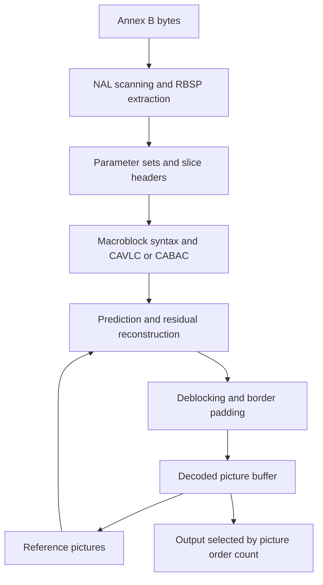

# H.264 video decoding

LogitOS’s H.264 decoder converts Annex B byte streams into planar, 8-bit YUV 4:2:0 pictures. The C implementation under `c/lib/video/` parses parameter sets and slices, decodes coefficients, reconstructs macroblocks, filters pictures, and manages reference storage and presentation order. Preview and the browser call its public interface in `c/lib/video/h264.h`.

## Entry points and input

The caller creates an opaque `h264dec` with `h264_open()` and releases it with `h264_close()`. `h264_decode()` returns a byte count and sets `got_frame` when it supplies an output picture. `h264_decode_pts()` accepts a timestamp alongside the input.

Advance the input cursor by the returned byte count and consume an emitted frame before calling the decoder again. Buffered output can produce a frame while consuming zero bytes. A picture boundary can also return zero bytes without emitting a frame: the decoder has completed the preceding picture and updated its internal state. With nonempty input, retry the unconsumed bytes so decoding can continue.

At the end of the stream, call `h264_flush()` repeatedly. It completes the picture under reconstruction and returns one pending picture per successful call. A return value of zero ends the drain.

The public errors distinguish malformed input (`H264_ERR_CORRUPT`), unsupported syntax (`H264_ERR_UNSUPPORTED`), and allocation failure (`H264_ERR_OOM`). The interface contract directs callers to close the decoder after a negative decode result.

For container input, `media_annexb_headers()` in `c/lib/media/demux.c` emits stored SPS and PPS parameter sets with start codes. `media_to_annexb()` converts samples containing NAL lengths into Annex B samples. Both Preview and the browser use these helpers before feeding the decoder.

## Pipeline and state

`c/lib/video/h264.c` coordinates decoding. Its slice loop connects the parser, macroblock layer, reconstruction functions, and picture storage.

The sequence parameter set, `sps_t`, holds geometry, profile and picture-order information, scaling matrices, and selected video usability information. The picture parameter set, `pps_t`, selects entropy coding, prediction weights, transforms, and filter controls. Both structures live in `c/lib/video/h264_int.h`.

A macroblock covers 16 × 16 luma samples and 8 × 8 samples in each chroma plane. Its `mbinfo_t` records prediction modes, coefficient counts, quantization parameters, references, and motion vectors. Neighbour derivation and deblocking read this state. `c/lib/video/h264_dpb.c` zeroes the metadata allocation for each picture because later calculations also read fields belonging to uncoded blocks.

Picture storage is allocated as pictures become live. Processed NAL units receive temporary RBSP allocations; reference pictures can also retain motion information for subsequent B pictures.

## NAL and slice parsing

The Annex B scanner in `c/lib/video/h264.c` locates start codes and dispatches SPS, PPS, and coded slice units. `h264_nal_to_rbsp()` in `c/lib/video/h264_nal.c` removes the NAL header and emulation-prevention bytes to produce the raw byte sequence payload, or RBSP.

`c/lib/video/bs.h` provides fixed-width and Exp-Golomb reads with a sticky error flag. The parameter and slice parsers combine checks of that flag with checks on geometry, references, crop offsets, and parameter-set availability.

Scaling-list inheritance is resolved while parsing parameter sets. `build_levelscale()` precomputes inverse-quantization factors in each PPS. Reconstruction then receives effective scaling values, keeping list inheritance and fallback decisions in the parser.

A slice header selects its PPS, references, quantization settings, prediction weights, and deblocking controls. `decode_slice()` builds reference lists and walks macroblock addresses. The orchestrator completes the current picture when it encounters a slice beginning at macroblock zero for the next picture.

## Entropy decoding

The PPS selects context-adaptive variable-length coding, CAVLC, or context-adaptive binary arithmetic coding, CABAC. `c/lib/video/h264_mb.c` shares the macroblock decoding structure between them, choosing the entropy operation at each syntax read. Both paths feed the same reconstruction functions, so whole-stream CAVLC comparisons also exercise reconstruction used by CABAC streams.

### CAVLC

`cavlc_decode()` in `c/lib/video/h264_cavlc.c` uses codeword tables from `c/lib/video/h264_tables.h`. It reads coefficient counts and trailing ones, signed levels, total zeros, and runs between coefficients. Neighbouring coefficient counts select the coding context; chroma DC uses dedicated tables.

The macroblock layer distinguishes blocks containing 16 coefficients, AC blocks containing 15 coefficients, and chroma DC blocks containing four coefficients. This distinction determines which syntax elements are present. For an 8 × 8 transform, four CAVLC coefficient groups are interleaved into one 64-coefficient block.

### CABAC

`c/lib/video/h264_cabac.c` implements context decisions, bypass decoding, and termination. Its 460 contexts are initialized from slice type, quantization parameter, and the initialization tables in `c/lib/video/h264_cabac_tables.h`. Context selection that depends on neighbouring macroblocks lives in `c/lib/video/h264_mb.c`.

Residual decoding walks coefficient significance positions forwards, then decodes levels backwards through those positions. An 8 × 8 luma residual is decoded as one block containing 64 coefficients. Both entropy paths return coefficients in scan order, giving reconstruction a common input.

## Prediction and reconstruction

`c/lib/video/h264_pred.c` implements nine intra modes for both 4 × 4 and 8 × 8 luma blocks, four modes for 16 × 16 luma, and four chroma modes. The 8 × 8 luma path filters reference samples before prediction.

Neighbour availability accounts for picture edges, slice membership, coding order, and constrained intra prediction. Within an intra macroblock, prediction and residual reconstruction alternate block by block because later blocks use samples reconstructed by earlier blocks.

Residual reconstruction applies inverse quantization, an integer inverse transform, addition to the prediction, and clipping to the sample range. The macroblock layer wires the DC Hadamard transforms for intra 16 × 16 luma and chroma into this process. It also handles skipped macroblocks and uncompressed I_PCM samples.

Transform pass order matters because intermediate shifts truncate. The 4 × 4 transform applies columns before rows; the 8 × 8 transform applies rows before columns. These orders are preserved in `c/lib/video/h264_pred.c`.

## Motion compensation

Inter macroblocks divide into partitions down to 4 × 4 luma samples. P slices predict from reference list 0. B slices use either list or combine predictions from both. Motion predictors are derived in `c/lib/video/h264.c`; the macroblock layer reads coded differences and applies them.

B slices implement spatial and temporal direct prediction. Reference pictures retain motion vectors and the picture order counts of their referenced pictures. Recording picture identity at picture completion lets temporal direct prediction map that motion into current reference lists after DPB slots have been recycled.

Interpolation and weighting live in `c/lib/video/h264_mc.c`.

| Component | Operation |
|---|---|
| Luma | A six-tap filter produces half-sample values; averaging produces quarter-sample positions. |
| Chroma | Bilinear interpolation produces eighth-sample positions. |
| Prediction from both lists | Interpolated blocks are averaged or combined with weights. |
| Weights | P and B prediction can use header weights; B prediction can also derive weights from picture order counts. |

Reference planes carry a replicated border of 32 samples, defined by `H264_PAD` in `c/lib/video/h264_int.h`. The orchestrator uses that border for nearby motion accesses and builds scratch blocks from clamped picture coordinates for accesses farther away. Motion-vector components use floor division when deriving integer positions and fractions, preserving the geometry of negative vectors.

## Deblocking and picture completion

`finish_picture()` in `c/lib/video/h264.c` performs these operations in order:

1. Apply deblocking using macroblock metadata.
2. Replicate picture edges into the reference border.
3. Store motion information for later direct prediction.
4. Update reference markings.
5. Free the current picture’s macroblock metadata.

Motion information is stored before reference marking because marking commands can release pictures whose identities are still needed during that step.

`c/lib/video/h264_deblock.c` traverses macroblocks in raster order, processing vertical edges before horizontal edges within each macroblock. Boundary strength depends on intra coding, residual coefficients, reference-picture identity, and motion differences. The B prediction calculation handles exchanged reference lists when comparing adjacent blocks.

Quantization parameters and slice offsets select filter thresholds. The filter handles disabled filtering, suppression across slice boundaries, and the edge spacing associated with an 8 × 8 transform. Filtering precedes subsequent prediction from the picture, making it part of the reconstruction loop.

## Decoded picture buffer

The **decoded picture buffer**, or DPB, serves prediction and presentation. A displayed picture can remain available as a reference, while a completed picture can wait for its place in presentation order.

`c/lib/video/h264_dpb.c` owns allocation, reference marking, reference lists, picture order counts, and output selection. Each `pic_t` records reference use and pending output. Its storage becomes releasable when both uses have ended, subject to the lifetime of an emitted frame.

P reference lists order short-term pictures by picture number and append long-term references. B lists arrange short-term pictures around the current picture’s order count. Slice commands can modify either list. Multiple entries can name the same picture and carry different prediction weights.

`h264_set_reorder_depth()` uses the VUI reorder count when bitstream restrictions are present. Otherwise it selects zero delay for picture-order type 2 or derives a delay from picture size and level. `h264_bump_one()` selects the pending picture with the smallest picture order count and breaks ties by decode order. When an IDR slice triggers completion of the preceding picture, the orchestrator drains pending output before starting the new numbering sequence.

`MAX_DPB` provides 34 metadata slots. Pixel planes and retained motion fields are allocated as needed, so the slot count describes metadata capacity.

## Output frames and timestamps

`h264frame`, defined in `c/lib/video/h264.h`, describes decoder-owned output.

| Field | Meaning |
|---|---|
| `y`, `u`, `v` | Pointers to planar 8-bit samples. |
| `width`, `height` | Reported output dimensions in luma samples. |
| `stride_y`, `stride_c` | Row spacing in bytes for luma and chroma. |
| `poc` | Picture order count used for output ordering. |
| `pts` | Caller-supplied timestamp or `H264_NOPTS`. |

Read each plane row by row using its stride. Use or copy the samples before the next decode or flush call, or before closing the decoder. An emitted picture that has finished its reference use is released on the next decode or flush entry.

`h264_decode_pts()` attaches its supplied value when a picture starts and stores it on that picture through DPB reordering. Feed each access unit with its timestamp, retaining the same timestamp while retrying its unconsumed bytes. The browser follows this pattern in `c/apps/gui/browser/js/media/media_src.c`.

`h264_stream_info()` reports geometry and timing from the first present SPS in parameter-set storage. Its frame-rate calculation is the VUI time scale divided by twice the number of units per tick; the reported rate is zero when timing is absent.

## Supported scope and bounds

The implementation and generated stream matrix cover decoding paths used by Baseline, Main, and High streams.

| Area | Implemented scope or stored bound |
|---|---|
| Samples | Progressive frames, 8-bit luma and chroma, YUV 4:2:0. |
| Slices | I, P, and B with CAVLC or CABAC. |
| Prediction | Intra modes, multiple references, spatial and temporal direct modes, weighted prediction. |
| Transforms | 4 × 4 and 8 × 8 transforms, DC Hadamard transforms, scaling matrices. |
| Parameter storage | 32 SPS entries and 32 PPS entries. |
| References | Parser upper checks of 16 reference pictures and 16 active entries per list. |
| VUI buffering | Parser upper checks of 16 reordered pictures and 16 buffered frames. |
| Geometry | Parser upper checks of 1,024 macroblocks per axis. |

The parser checks are in `c/lib/video/h264_nal.c`; storage layouts are in `c/lib/video/h264_int.h`.

Correction recorded on 2026-11-02: the opening comment in `c/lib/video/h264.h` still describes a Baseline decoder and lists CABAC, B slices, and the 8 × 8 transform as unsupported. The current entropy engine, macroblock layer, and transforms implement those features, matching the broader scope described in `c/lib/video/h264_int.h`.

## Tests

Run the following commands from the repository root. This page records source inspection on 2026-11-02; builds and tests were not run during this review.

| Command | Checks defined by the target |
|---|---|
| `make test-h264` | Runs bounds checks, generates streams using FFmpeg with libx264, compares 27 named cases against reference YUV, checks the committed fixture CRC, and invokes timestamp checks. |
| `make test-h264-units` | Exercises prediction and transforms, motion compensation, deblocking, CABAC initialization and arithmetic, and scaling-matrix parsing. |
| `make test-h264-bounds` | Uses address and undefined-behaviour sanitizers with crafted slice and crop inputs; depends on mutation controls. |
| `make test-h264-diff` | Generates the wider matrix and reports mismatching sample counts by plane. |
| `make test-h264-negctl` | Generates a High-profile stream requesting CABAC, B pictures, and 8 × 8 transforms, then compares decoded samples against FFmpeg. |
| `make test-video` | Boots LogitOS in QEMU and compares the guest decoder’s visible-plane CRC with the committed checksum. |

`tools/genvideo.sh` requests combinations covering intra pictures, inter prediction, multiple slices, references, deblocking, direct modes, B pyramids, weighting, and scaling matrices. `tests/unit/h264test.c` compares visible samples in output order and checks for extra or missing frames. Its timestamp mode rejects absent timestamps and duplicate values, then prints the number of inversions in the returned sequence.

The bounds controls in `tests/h264.mk` build modified source copies that restore earlier missing guards. One control requires an AddressSanitizer heap-buffer-overflow report involving macroblock decoding. The other requires the old crop parser to report an incorrect output size. The positive target then checks rejection by the current implementation.

The guest test uses `tests/guest/video/vidcheck.c` and `tests/boot/run-video-test.sh`. It computes a CRC over visible Y, U, and V rows and compares it with `tests/fixtures/video/sample.crc32`, exercising decoding with the target build and application allocator inside LogitOS.

## Limitations

- The parser rejects fields and MBAFF, chroma formats other than 4:2:0, bit depths above eight, transform bypass, multiple slice groups, redundant-picture syntax, data partitioning, SP/SI slices, and nonzero picture-order type 1 cycle lengths. See `c/lib/video/h264_nal.c` and `c/lib/video/h264.c`.
- SPS parsing also accepts Extended and additional profile identifiers through `has_high_extension()`. Profile and level conformance checks are incomplete: constraint flags are consumed and discarded, and the level supplies a fallback DPB calculation. The geometry checks describe parser ceilings; picture allocation also depends on available memory.
- Input buffers must preserve complete NAL units. The scanner treats the buffer end as a NAL end and retains no partial-NAL assembly buffer. SEI, access-unit delimiters, and other unhandled NAL types are skipped in `c/lib/video/h264.c`.
- Crop handling subtracts all four offsets from dimensions while output pointers retain the coded picture origin. Nonzero left or top cropping selects the wrong visible origin. Output dimensions are refreshed when the macroblock grid changes, leaving crop changes within the same grid stale. See `c/lib/video/h264.c` and `c/lib/video/h264_dpb.c`.
- Slice lookup assumes ascending raster addresses. Storage holds 64 slice starts, but the count continues increasing beyond that capacity, allowing later lookups beyond the array. Picture deblocking also uses the latest slice header’s controls for the whole picture. See `c/lib/video/h264.c`, `c/lib/video/h264_int.h`, and `c/lib/video/h264_deblock.c`.
- `c/lib/video/h264.c` records sparse differences of one sample value on some low-QP streams and streams using JVT scaling matrices. `tests/h264.mk` excludes the generated JVT case from the 27-case comparison gate and includes it in the wider diagnostic comparison.
- `tests/unit/h264_cavlc_test.c` is excluded from `test-h264-units` because its local encoder disagrees with the decoder’s level coding, as documented in `tests/h264.mk`. Whole-stream comparisons exercise CAVLC.

## Source map

| File | What it contains |
|---|---|
| `c/lib/video/h264.h` | Public API, frame layout, timestamps, and error codes. |
| `c/lib/video/h264_int.h` | Parameter sets, slices, macroblock metadata, pictures, and module contracts. |
| `c/lib/video/h264.c` | Annex B scanning, slice orchestration, motion derivation, and public entry points. |
| `c/lib/video/h264_nal.c` | RBSP extraction, parameter sets, scaling lists, VUI, and slice headers. |
| `c/lib/video/bs.h` | Bit reads, Exp-Golomb decoding, and RBSP termination checks. |
| `c/lib/video/h264_mb.c` | Macroblock syntax, entropy dispatch, and reconstruction. |
| `c/lib/video/h264_cavlc.c` | CAVLC coefficient decoding. |
| `c/lib/video/h264_tables.h` | CAVLC codeword tables. |
| `c/lib/video/h264_cabac.c` | CABAC arithmetic engine and residual decoding. |
| `c/lib/video/h264_cabac_tables.h` | CABAC context initialization tables. |
| `c/lib/video/h264_pred.c` | Intra prediction, inverse quantization, and transforms. |
| `c/lib/video/h264_mc.c` | Motion interpolation and prediction weighting. |
| `c/lib/video/h264_deblock.c` | Boundary strengths and filtering. |
| `c/lib/video/h264_dpb.c` | Picture allocation, references, ordering, and output lifetime. |
| `c/lib/media/demux.c` | Container configuration and sample conversion to Annex B. |
| `c/apps/gui/preview/preview.c` | Preview’s decoder integration. |
| `c/apps/gui/browser/js/media/media_src.c` | Browser sample feeding, timestamps, and frame delivery. |
| `tests/h264.mk` | Host comparisons, module tests, and bounds controls. |
| `tools/genvideo.sh` | Synthetic streams and reference-YUV generation. |
| `tests/unit/h264test.c` | Sample comparison, frame counts, CRCs, and timestamp checks. |
| `tests/unit/h264_diff.c` | Aggregate sample mismatch reporting. |
| `tests/unit/h264_bounds_test.c` | Crafted crop and slice regression inputs. |
| `tests/unit/h264_bounds_mutate.py` | Source-copy mutations for bounds controls. |
| `tests/guest/video/vidcheck.c` | Guest decoding and visible-plane CRC calculation. |
| `tests/boot/run-video-test.sh` | QEMU execution and pinned CRC comparison. |
| `Makefile` | Application video linkage and the guest test target. |

## See also

- [Media containers and playback clock](media-containers.md)
- [Preview and Files](../userland/preview-and-files.md)
- [Libraries](overview.md)
- [Writing tests](../contributing/writing-tests.md)