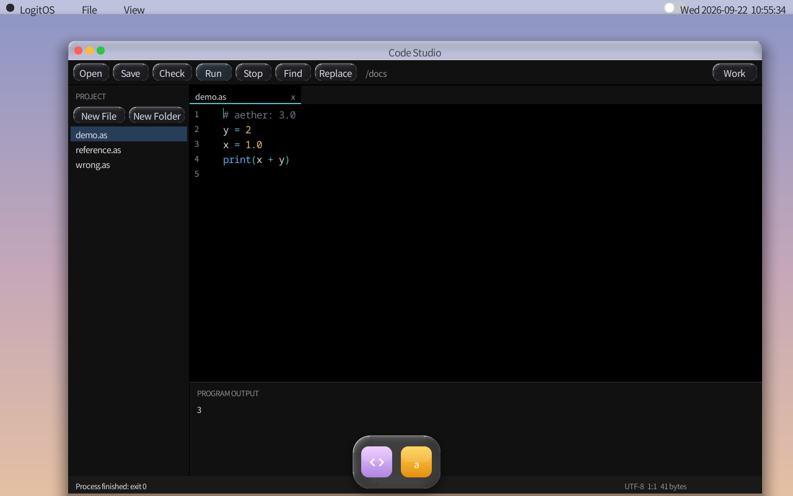

# A3 mixed numeric operations — 2026-09-22

The reported Studio program was valid syntax but rejected by the former
same-type arithmetic rule:

```python
# aether: 3.0
y = 2
x = 1.0
print(x + y)
```

It now prints `3`, with an `f64` expression result. The change covers binary
`+ - * / % **` and numeric comparisons. A concrete `f64` operand selects `f64`;
otherwise a concrete `f32` operand selects `f32`. Integer operands convert with
their original signedness, and variables keep their declared storage types.
Plain assignments, arguments, integer-only operations, bool and Any retain
their existing checks. Float compound arithmetic accepts integer operands;
storing a promoted float into an integer or f64 into f32 is still rejected.
Integer-to-float rounding follows the destination precision, including in
comparisons. The previous float `**=` restriction remains.

`sema/numeric.c` owns the common type decision. LLVM emits value conversions;
Studio's existing checked-tree evaluator uses the same decision and rounds
f32 operands/results explicitly. That evaluator previously refused float
arithmetic even after checking, so a checker-only fix would still fail Run.
The evaluator now uses the existing libm implementations for remainder/power;
`/bin/as` links an archive to avoid duplicate mini-libc math definitions.
Host compiler and mutation-test links include `-lm` for non-Darwin hosts too.

## Evidence

- `make BUILD=build-numeric -j6 all build-numeric/disk.img` passed. Log:
  `build-numeric/full-build.log`.
- `test-as-promotion`: 32 rejection cases plus the mixed fixture and exact
  screenshot program at O0/O2 under ASan/UBSan passed. Replacing signed LLVM
  conversions with unsigned conversions was observed failing with
  `AssertionError`.
- `test-as-eval`: 64 checks passed, also under ASan/UBSan. Restoring the old
  float refusal with `AS_EVAL_NO_NUMERIC` produced 15 failures; the four
  existing controls also failed as expected. Logs:
  `build-a3-eval-mixed/{gate,asan}.log`.
- Float-power and f-string gates passed, including their pow-as-multiply and
  missing-GC-root controls.
- Conversion, assignment and generic gates passed with their controls.
  Log: `build-numeric/related-gates.log`.
- The core typed/native harness passed 263 checks:
  `build-numeric/typed-core.log`.
- `test-mk-wired`: 378 fragments, 377 reachable, one declared wrapper.

The new guest harness is `tests/boot/run-as-numeric.py`, wired through
`test-as-promotion-guest`. Its isolated disks contain hash-verified copies of
the tested `/bin/as`, `/studio.aex` and native `/mixed.aex`.

Baseline: `build-numeric/guest-baseline-final/result.json` records nine checks,
including AS3202 at `/docs/demo.as:4:9` and the real Studio failure screenshot.
Fixed: `build-numeric/guest-fixed/result.json` records sixteen checks. The
actual Studio Open → Check → Run flow prints `3` and exits zero. Its output
pixels match the `print(3.0)` reference and differ from the `print(4.0)` control.
The shell path prints exact `3\n`; the separately LLVM-compiled fixture prints
`mixed numeric ok\n` and exits zero. All test VMs were stopped afterward.



This validates these numeric operations in both current execution paths, not
the complete A3 language. The user's running VM and its disk were left alone;
the next normal `make run` must rebuild/repack after the old VM has exited.
Default `build/as.aex`, `build/asc` and `build/studio.aex` were also rebuilt
successfully; log: `build-numeric/default-apps.log`. Guest acceptance used the
explicitly recorded isolated artifacts, whose packaging hashes differ from
the default output.

## Build cleanup

Referenced logs, results and screenshots were preserved in the
[validation archive](evidence/2026-09-22/README.md) before removing temporary
build directories. Historical commands above retain their original output paths.
